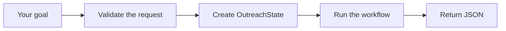

# Outreach Agent File Guide

This guide explains the files and common code patterns in the application after phases one and two.

The key distinction is: **schemas define the data format, state holds one request's data, and the workflow coordinates the work.**

## How a request moves through the application

When you submit a goal, this happens:

FastAPI uses the rules in `schemas.py` to check the request. The endpoint creates a fresh state, waits for the workflow to finish, and returns the result as JSON.

The application currently accepts goals and prepares structured records. Future research, qualification, and email-writing components will populate those records.

## The five application files

| File | What it does |
|---|---|
| [app/main.py](app/main.py) | Creates the FastAPI application and connects its endpoints. Uvicorn loads this application when you start the server. |
| [app/api/outreach.py](app/api/outreach.py) | Defines `POST /outreach`. Receives the validated goal, creates a fresh state, calls the workflow, and returns its result. |
| [app/models/schemas.py](app/models/schemas.py) | Defines what information each record contains and checks that incoming data follows those rules. |
| [app/orchestration/state.py](app/orchestration/state.py) | Holds one request's goal, progress, and results together. Each request gets its own state. |
| [app/orchestration/workflow.py](app/orchestration/workflow.py) | Coordinates the processing steps. Currently it changes progress to `"skeleton_ready"` and returns the state. Future research and qualification steps will be connected here. |

## The records inside schemas.py

Each class represents a different kind of record:

| Class | Meaning |
|---|---|
| `OutreachRequest` | The user's input: one outreach goal. |
| `Prospect` | A potential customer, with company information, useful signals, and source references. |
| `Qualification` | A prospect's score, selection decision, and reasons. |
| `OutreachStrategy` | Why to contact the prospect, how the product could help, and what action to suggest. |
| `EmailDraft` | The email subject and body for a prospect. |
| `ReviewResult` | The reviewer's decision, score, and feedback about a draft. |

These classes **store and validate information**. The future researcher, qualifier, writer, and reviewer will produce that information.

For example, a prospect might have ID `"p1"`. Its qualification, strategy, draft, and review all use `prospect_id="p1"` to refer to that company.

## Installation and documentation files

| File | Meaning |
|---|---|
| [pyproject.toml](pyproject.toml) | Lists the project's required packages, supported Python version, installation settings, and test settings. |
| [.gitignore](.gitignore) | Tells Git to ignore installed packages and generated files. |
| [README.md](README.md) | Instructions for installing, starting, testing, and understanding the application. |
| [plan.md](plan.md) | Records the development phases, completed work, and next step. |
| [FILE_GUIDE.md](FILE_GUIDE.md) | This explanation of the project's files and code patterns. |

## The __init__.py files

The four `__init__.py` files organize the Python packages:

- [app/__init__.py](app/__init__.py): the overall application package.
- [app/api/__init__.py](app/api/__init__.py): the endpoint package.
- [app/models/__init__.py](app/models/__init__.py): the data-definition package.
- [app/orchestration/__init__.py](app/orchestration/__init__.py): the state and workflow package.

These files make it possible to organize imports using package paths such as `app.models.schemas`.

## The test files

The test files check that the application behaves correctly:

| File | What it checks or provides |
|---|---|
| [tests/conftest.py](tests/conftest.py) | Fresh example records shared by tests. These are sample companies and contacts. |
| [tests/test_schemas.py](tests/test_schemas.py) | Required fields, valid text, score limits, decisions, and JSON conversion. |
| [tests/test_state.py](tests/test_state.py) | Correct starting state and independent data for separate requests. |
| [tests/test_workflow.py](tests/test_workflow.py) | Progress updates and preservation of existing information. |
| [tests/test_outreach_api.py](tests/test_outreach_api.py) | The complete request/response flow and API documentation using simulated requests. |

The tests run locally without calling external services. Tests that need to inspect the workflow can temporarily replace it with a fake function.

## Common code patterns

| Code | Plain-language meaning |
|---|---|
| `from ... import ...` | Bring a class or function from another module into this file. |
| `class Prospect(BaseModel)` | Define a structured record whose incoming data Pydantic validates. |
| `goal: GoalText` | A field named `goal` that follows the goal-validation rules. |
| `Annotated[str, ...]` | Combine the text type with extra validation rules. |
| `ConfigDict(extra="forbid")` | Reject fields the record does not recognize. |
| `list[Prospect]` | A list of prospect records. |
| `dict[str, EmailDraft]` | Drafts organized under text keys, such as `"p1"`. |
| `Field(default_factory=list)` | Give every new record its own empty list. |
| `Field(default_factory=dict)` | Give every new record its own empty dictionary. |
| `NonEmptyText \| None = None` | This information can be unknown or omitted. |
| `Literal["initialized", "skeleton_ready"]` | Describe the allowed progress labels when the state is validated. |
| `async def` / `await` | Define an asynchronous function and wait for its result. The endpoint waits for the workflow before returning a response. |
| `model_dump()` / `model_dump_json()` | Convert a record into a Python dictionary or JSON text, respectively. |
| `@pytest.fixture` | Define example data or a helper that pytest supplies to tests requesting it by name. |
| `@pytest.mark.parametrize` | Run one test with several different examples. |
| `assert` | Check an expectation; a mismatch fails the test. |

## Suggested reading order

Start reading `app/api/outreach.py`, then follow its calls into `app/orchestration/state.py` and `app/orchestration/workflow.py`. Keep `app/models/schemas.py` open beside them to understand the records they use.

Read `app/main.py` to see how the endpoint is connected to the web application. Then read the corresponding test files to see examples of valid input, invalid input, and expected results.
