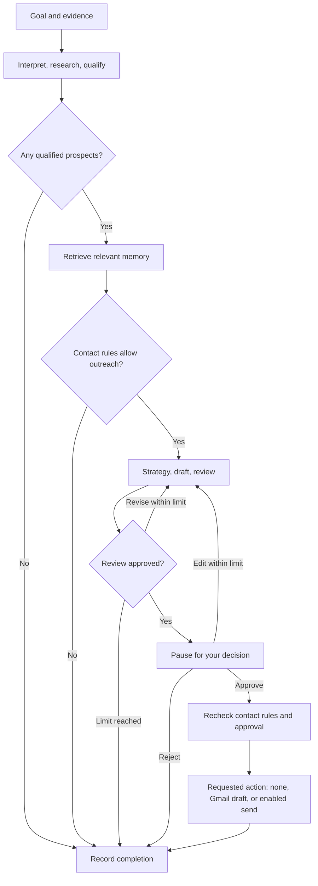

# Outreach Agent File Guide

This guide explains the original research path and the complete outreach workflow added through phase 30, including phase 3.5. Each section identifies when the work was added. Optional model routing, concurrency, and advanced retrieval remain disabled or conservative until their conditions are met; live services need your configuration.

V1 now uses a CLI, a menu you interact with in the terminal. Run `python -m app.cli`, or `python -m app.cli --demo` for fictional data without keys. It runs the existing workflow directly. SQLite stores real runs locally; a web UI, Telegram, and WhatsApp are deferred. The optional API still works.

The key distinction is: **schemas define the data format, state holds one request's data, the graph controls execution, and the workflow function connects the application to the graph.**

Some terms used below:

| Term | Plain meaning |
|---|---|
| CLI / terminal | A program you interact with by typing answers or commands in a text window. |
| API endpoint | An address another program calls to submit or read information. |
| Schema / record | A description of allowed fields, and a validated collection of values following that description. |
| Graph / node | Connected workflow steps, and one step within that workflow. |
| SDK / client | A provider's software library, and the object our code uses to request a response. A fake client supplies local examples. |
| Repository | Functions that read and write stored application information. |
| SQLite / PostgreSQL | A database in a local file, or a database running as a service. |
| Checkpoint | Saved progress for one workflow so it can resume later. |
| Hash / fingerprint | A code calculated from the actual message content, used to recognize an unchanged or repeated message. |
| MIME | The standard format used to put an email's headers and body together. |
| Embedding / semantic retrieval | Numbers representing text, and searching by similarity of meaning. These are optional here. |
| Subgraph | A group of workflow steps kept together inside a larger workflow. |

## What we built in each phase

The first sections record phases one through four, including phase 3.5. The next table describes the implemented work through phase 30 and the optional features that still need configuration or measurements.

### Phase 1: Build the application foundation

We made it possible to submit a goal and receive a separate record for that request.

- Set up the Python project, its packages, and the application folders.
- Created `POST /outreach` to accept the user's goal. It trims surrounding whitespace and rejects missing, blank, incorrectly typed, extra, or overly long input.
- Created `OutreachState` to hold the goal, empty result collections, and progress. Every request gets its own collections.
- Added `run_workflow`, the coordinator that changes progress from `initialized` to `skeleton_ready` and returns the state.
- Connected the endpoint to the coordinator and documented installation, startup, example requests, and testing.

The main files were `app/main.py`, `app/api/outreach.py`, `app/models/schemas.py`, `app/orchestration/state.py`, `app/orchestration/workflow.py`, and `pyproject.toml`. We also added package files, tests, and setup documentation.

**What worked after this phase:** submitting a valid goal returned that goal, empty results, and `skeleton_ready`. Verification included 44 passing tests, a fresh installation, a live request, and the API documentation page.

### Phase 2: Give results a consistent format

We defined what each future agent's result should contain so the next agent can understand it.

- Added `Prospect`, `Qualification`, `OutreachStrategy`, `EmailDraft`, and `ReviewResult` in `app/models/schemas.py`.
- Defined rules for required text, scores, decisions, optional company details, and unexpected fields.
- Updated `app/orchestration/state.py` to hold these records. Added `qualification_results` to retain scores and reasons alongside the selected prospects.
- Updated tests to check the new formats, separate collections, and conversion to and from JSON, the text format used in API responses.
- Checked that API responses and generated documentation included the new formats.

The main work was in `schemas.py`, `state.py`, `tests/conftest.py`, and the schema, state, workflow, and API tests. Existing files were expanded rather than creating a second application.

**What worked after this phase:** the application had clear formats for company details, qualification decisions, strategies, drafts, and reviews. Future agents will produce those records. The full suite reached 119 passing tests.

### Phase 3: Add one shared way to call a model

We gave future agents a common function for asking a model to return a particular kind of record.

- Created `app/models/client.py` with `generate_structured`. It receives instructions, input text, the expected record class, and a client, then returns a validated record.
- Added `FakeModelClient`, which returns preset responses in order and records each call for tests.
- Added `OpenAIModelClient`, which handles real model requests in one place and reads explicitly configured credentials and a model name.
- Added clear errors for failed requests, missing or invalid output, incomplete responses, and refusals. Added connection cleanup for the real client.
- Created `tests/test_client.py` to check the fake and the real SDK using responses supplied locally.
- Added the OpenAI package to `pyproject.toml`, optional settings to `.env.example`, and rules in `.gitignore` to exclude local credential files. Updated the README with usage examples.

**What worked after this phase:** future agents can request validated records through a real client or a fake. The full suite reached 166 passing tests, and the README's fake-client example was checked. No live model calls were needed.

### Phase 3.5: Let LangGraph run the existing workflow

We moved the existing initialization step into LangGraph, the library that now controls the order of workflow steps. The execution path is `START → initialize → END`.

- Added LangGraph to `pyproject.toml` and installed it in the project's environment.
- Created `app/orchestration/graph.py` using the existing `OutreachState`. Its initialize node returns only `{"current_step": "skeleton_ready"}`. The graph keeps the goal and existing results.
- Updated `run_workflow(state)` in `app/orchestration/workflow.py` to await the graph, validate its result, and update and return the original record. The endpoint continues calling this same function.
- Created `tests/test_graph.py` and expanded the workflow and API tests to check compilation, execution, preserved information, separate requests, graph delegation, and errors.
- Updated the README, plan, and this guide with the new execution path. The state model, domain records, model client, and FastAPI endpoint stayed compatible.

**What worked after this phase:** `POST /outreach` now runs through LangGraph and still returns the accepted goal, empty results, and `skeleton_ready`. All 166 original tests passed before the change. Afterward, the 35 focused tests and the full suite of 179 tests passed without external services. Installation and the dependency check succeeded. A live server returned `200` for a valid goal, `422` for a blank goal, and `200` for `/docs` without OpenAI credentials.

The graph is compiled once, but each invocation has its own request state. This phase adds no research, qualification, memory, writing, review, Gmail actions, checkpointing, interrupts, subgraphs, or model routing. Those remain later steps.

### Phase 4: Turn supplied research material into prospect records

We added a researcher and connected it to LangGraph. The graph now runs `START → research → END`.

- Created `app/agents/researcher.py`. `Researcher.research` receives a goal and material, asks the existing model client for structured output, and returns `Prospect` records.
- Created `app/prompts/researcher.py` with instructions to use supplied evidence, preserve references, leave unknown details empty, and support different outreach goals.
- Added `ResearchResult` to `schemas.py` as a wrapper around the existing prospect list. Added the optional request field `research_material` without changing the existing prospect fields.
- Created `app/orchestration/nodes/research.py`. Its node adapts state to the researcher and returns partial updates. Its `ResearchContext` holds the researcher and material for just that invocation.
- Updated `graph.py`, `workflow.py`, and the progress labels in `state.py`. The successful status is now `research_complete`; the earlier labels remain valid for existing records.
- Updated the endpoint to accept material and provide an injectable client. It closes clients it creates and reports missing configuration or model failures as HTTP errors.
- Added researcher and node tests, expanded graph, workflow, API, and SDK tests, and added comments and these explanations.

**What worked after this phase:** a goal and supplied material can pass through the real graph and produce typed prospects using a fake or real model client. All 179 baseline tests passed before changes. Afterward, 136 focused tests and the full suite of 233 tests passed without external-service calls. The dependency check passed. A live server accepted a goal with `200`, rejected a blank goal with `422`, reported missing model settings with `503` when material was supplied, and served `/docs` with `200`.

Both README fake-client examples were run successfully, including the complete graph example returning an academic prospect with its supplied source. The fake examples check the program's behavior and do not perform actual research. The researcher checks names and source references against the supplied text, but does not verify websites or prove every statement's accuracy. Search, qualification, writing, reviews, memory, approvals, and Gmail remain later work.

### Phases 5 to 30: Add the complete outreach workflow

We implemented the remaining workflow after your request to build all phases. The original `POST /outreach` research endpoint still works. The new `POST /runs` endpoint uses the complete graph and returns a saved run that can pause for approval. We extended the existing project, schemas, and model client.

| Phase | What we added | Main files | What the checks cover |
|---|---|---|---|
| 5 | Replaceable search with typed text and URLs, connected to the researcher. | `tools/search.py`, `agents/researcher.py`, `nodes/discovery.py` | Queries, preserved references, fake results, and provider failures. |
| 6 | Qualification and an explicit score threshold of 70. | `qualification/qualifier.py`, `nodes/qualification.py` | Scores, prospect associations, selection, and rejected results. |
| 7 | Routes for no matches, eligible contacts, review decisions, and approval. | `orchestration/routing.py`, `full_graph.py` | Empty results end and eligible results reach the correct next step. |
| 8 | Shared goal interpretation for jobs, academics, sales, networking, and other categories. Added `entity_type` for person-only targets. | `agents/goal_interpreter.py`, `models/workflow.py`, `schemas.py`, `prompts/goal.py` | Original goals survive; different categories work; person targets have an explicit type. |
| 9 | Relationship facts, contacts, interaction history, and portable database tables. | `memory/`, `db/` | Saved facts survive a new repository and remain separate by contact; tables compile for PostgreSQL. |
| 10 | Relevant memory retrieval and optional Gmail-history ingestion. | `memory/retrieval.py`, `nodes/memory.py` | Old, expired, unrelated, and other-contact information is excluded. |
| 11 | Deterministic contact rules and duplicate-contact checks. | `security/contact_policy.py`, `nodes/contact.py` | Opt-outs, active conversations, recent contact, timing, missing addresses, and pending actions block outreach. |
| 12 | A grounded message strategy using goal, evidence, sender background, and memory. | `strategy/builder.py`, `nodes/strategy.py`, `prompts/strategy.py` | Correct prospect associations and context passed to strategy. |
| 13 | Subject/body writing and revisions using supplied context. | `agents/writer.py`, `nodes/writing.py`, `prompts/writer.py` | Typed drafts, ID checks, and rejection of header line breaks. |
| 14 | Automated review against the research, strategy, and relationship context. | `agents/reviewer.py`, `nodes/review.py`, `prompts/reviewer.py` | Review records, scores from 0 to 1, and feedback. Model quality still needs actual evaluations. |
| 15 | A hard revision limit, initially one revision, shared by automatic rewrites and human edits. | `nodes/writing.py`, `nodes/review.py`, `nodes/approval.py` | Rejection can lead to revision; exhaustion stops for manual review. |
| 16 | In-memory, durable SQLite, and optional PostgreSQL checkpoints. | `orchestration/checkpoints.py`, `runs.py` | A paused run resumes after closing and reopening its SQLite checkpointer. |
| 17 | A pause showing the prospect, evidence, memory, strategy, recipient, and draft. | `nodes/approval.py`, `models/workflow.py` | Nothing reaches Gmail before human approval; changed content needs a new approval. |
| 18 | Saved-run, decision, event, and retry endpoints. | `api/runs.py`, `api/approvals.py`, `orchestration/runs.py` | Existing runs resume; unknown IDs, stale decisions, and concurrent resumes are rejected. |
| 19 | Gmail thread search and reading through a replaceable HTTP adapter. | `tools/gmail.py`, `nodes/memory.py` | HTTP requests, plain-text decoding, exact contact matching, and source identifiers. |
| 20 | Gmail draft creation after review and human approval. | `tools/gmail.py`, `nodes/external.py` | Approved content reaches a fake draft operation once. |
| 21 | A guarded sending path and persistent protection against duplicate actions. Sending is disabled by default. | `nodes/external.py`, `memory/repository.py`, `security/contact_policy.py` | Approval/version checks, a second policy check, replay protection, and uncertain responses. Every send test uses a fake. |
| 22 | Outcome records and source-backed memory extraction. | `nodes/external.py`, `memory/extraction.py`, `memory/repository.py` | Drafted, sent, blocked, rejected, failed, and uncertain outcomes remain distinct. Unsupported quotes are rejected. |
| 23 | A separate reply workflow and a reply API. | `orchestration/replies.py`, `api/memory.py` | Reply categories, explicit opt-outs, timing, source retention, and duplicate processing. No automatic follow-ups. |
| 24 | Execution events for steps, routes, calls, timing, token usage when available, pauses, resumes, and external actions. | `observability.py`, `orchestration/context.py`, `full_graph.py` | Events can explain the path a prospect took. |
| 25 | Four reference goal cases, component scoring, and an evaluation command. | `evals/cases.json`, `scoring.py`, `run.py` | Simulation exercises the workflow; deliberate regressions lower scores. Live model evaluation is a separate opt-in. |
| 26 | An optional model router that requires recorded measurements for each route. | `models/router.py` | Unmeasured or inadequate routes are rejected. No production model optimization has been selected. |
| 27 | Shared limits, timeouts, estimated cost reservations, bounded retries, request limits, API-key protection, and action/run locks. | `security/limits.py`, `settings.py`, `api/dependencies.py`, `orchestration/context.py`, `memory/repository.py` | Budgets persist across resume/retry, timeouts stop work, and simultaneous actions are constrained. |
| 28 | Bounded concurrent processing in prospect components. The default is one prospect operation at a time. | `nodes/common.py`, `security/limits.py` | Overlapping work keeps results attached to the right prospect and respects the configured concurrency. |
| 29 | Duplicate-memory consolidation, possible-conflict views, and optional semantic retrieval with an injected embedding function. | `memory/advanced.py`, `api/memory.py`, `nodes/memory.py` | Sources survive consolidation; fake vectors can improve a vocabulary mismatch. No vector database is enabled. |
| 30 | Separate research and message-preparation subgraphs, plus an inbound reply graph. | `orchestration/full_graph.py`, `replies.py` | They connect through the complete workflow while preserving revision and approval behavior. |

**What works now:** a complete run can interpret a goal, research supplied or searched evidence, qualify prospects, check memory and contact rules, prepare and review drafts, pause for a person, and record approved actions. All **360 tests pass**, including the original 233 checks, Groq coverage, and the V1 CLI checks. The earlier full-workflow installation in a fresh Python environment, the fictional demo, and actual local HTTP requests also passed. The detailed results are recorded in [plan.md](plan.md#complete-workflow-verification).

**What still needs configuration or measurement:** real Groq or OpenAI, Brave, Gmail, and PostgreSQL access are optional integrations requiring your settings. They were checked with local substitutes rather than live accounts. Sending requires explicit enablement plus approval of the current content. Real model-quality measurements, production model choices, external embeddings, and a vector database have not been configured. The cost control reserves a configured estimate per model attempt; it is not a guarantee of the provider's final bill.

### Provider update after phase 30: Use Groq

You chose Groq as the model provider. We extended the phase-three client boundary and the configuration used by phases 4–30, while keeping the same goals, records, graph, and approval rules.

- Added `app/models/groq_client.py`. It sends the requested record format to Groq, checks the returned JSON, reports failed/refused/incomplete output, and records token usage. It uses the already-installed HTTPX package.
- Updated `app/settings.py` to read `OUTREACH_MODEL_PROVIDER`. Updated `app/orchestration/runs.py` and `app/api/outreach.py` to use the selected provider. The full workflow creates its real client only when a model call is needed, so approval alone does not make another model call.
- Updated `.env.example` to select Groq and show `GROQ_API_KEY` and `GROQ_MODEL`. Existing installations keep the OpenAI default unless they explicitly select Groq.
- Updated `evals/run.py` so an explicitly requested live evaluation also uses your selected provider. Default evaluations remain local simulations.
- Added `tests/test_groq_client.py` for Groq request/response handling, errors, connection ownership, provider selection, research, complete runs, approval, and evaluation selection. These checks use local responses, not a real Groq account.
- Updated `tests/conftest.py` so tests use isolated settings and temporary data even when your shell has real account settings. Each test can explicitly supply the settings it needs.
- Added README explanations of each credential, startup, and the interface choices. A custom UI, Telegram bot, and WhatsApp adapter remain proposed work; `/docs` is the available browser interface today.

`GroqModelClient.from_env()` reads your key and model name. `generate_structured(instructions, input_text, response_model)` sends those instructions and the expected format to Groq, then returns the validated record. For example, requesting `Qualification` returns a prospect ID, score, selection decision, and reasons. `aclose()` closes a connection this client created. Best-effort JSON schema allows our existing optional fields; invalid records stop before they can be used.

**Checks:** the full suite now passes 343 tests, including 24 added provider checks. The original OpenAI behavior still passes. No live Groq requests were made, and the HTTPX dependency was already installed.

### Documentation updates between phases

After phase two, we collected the file explanations in this guide. Later phases added comments, model-client explanations, graph history, and researcher explanations. After phase four we first expanded the roadmap without adding code. Your clarification led to the complete workflow implementation described above. This guide, the README, and the plan now describe that code and distinguish it from optional integrations or later refinements.

After the V1 CLI work, we rewrote `README.md` for someone meeting the project for the first time, including a hiring reviewer. It now starts with the problem being solved and a fictional demo, then shows the workflow and the connections between files in two diagrams. It explains that both default database files use SQLite and that PostgreSQL is optional. The engineering decisions link to their implementation, so a reader can see the work behind each claim. Detailed API requests and advanced integration settings moved to `docs/API_GUIDE.md`. This documentation update does not change application behavior or claim measured business results.

**Checks for the documentation update:** the terminal demo reached approval, accepted a decision, recorded a fake draft, displayed events, and exited. Both fake-client examples in the integration guide ran successfully without credentials. All 154 local links and heading references were checked, and the code fences and Git whitespace checks passed. The previously passing 360-test suite remains the application verification record; this update changes documentation only.

A later explanation update expands the phase 25 evaluation files and the phase 5 search adapter below. It explains what each function receives and returns, why simulation scores do not establish real model quality, and how optional Brave results become evidence for research. It also separates search from model reasoning and documents the limits of snippet-based evidence. This adds reading guidance without changing workflow behavior.

**Checks for the explanation update:** the documented simulation command produced a JSON report with four cases, ten scores per case, and six fake model attempts per case without credentials. All 161 local links and heading references passed, code fences are balanced, and Git's whitespace check passed. The report was created in a temporary directory so existing local evaluation reports were preserved.

The next README revision follows your request for a shorter repository front page. It keeps implemented features, a quick start, tests, and links to the detailed guides. Future-work lists and the long file/decision tables were removed from the README. MIT license and contribution badges now appear below the title and link to their actual files. `docs/assets/workflow.svg` supplies one compact workflow image, with readable text and a description for accessibility. It shows the main approved path through research, qualification, relationship checks, writing, automated review, and the human decision. The detailed code explanations remain in this guide. The API and contribution guides were updated to describe the shorter README correctly. This documentation follow-up changes no application behavior.

**Checks for the shorter README:** the credential-free terminal demo reached approval and a fake Gmail draft using the documented menu steps. The workflow image was rendered and visually inspected; its SVG structure and accessible description were checked. Both badge URLs returned valid SVG images. All 125 local documentation links and heading references passed, code fences are balanced, and Git's whitespace check passed.

### V1 interface follow-up: Interact through the CLI

You chose the terminal for V1 so we can try real goals and configured keys before building other interfaces. This reuses the existing work: phase 3's model client, phase 9's relationship database, phase 16's saved progress, phases 17–18's approval flow, and phase 27's limits/recovery.

- Added `app/cli.py`. Its menu collects a goal, sender background, research notes or a search choice, and recipient addresses. It shows prospects, scores, drafts, outcomes, and execution events. It can approve, reject, edit, leave work paused, or retry a failed run. It builds the required decision IDs and versions internally.
- Added `app/orchestration/runtime.py` and updated `app/main.py`. The terminal and API now open the same database, checkpoint, and tool services through one helper. Exiting closes those connections; starting the terminal requires no HTTP server.
- Updated `app/memory/repository.py` with a bounded list of saved outreach runs. Reply-processing budget records are excluded. This changes queries, not the database table format.
- Updated `app/orchestration/runs.py` so cancelling active execution marks it failed, releases its run lock, and allows inspection/retry from saved progress. Existing budgets still apply. A hard process kill can leave a lock until its lease expires.
- Updated `pyproject.toml` to register the `outreach` command. `python -m app.cli` also works without using that shortcut. No new software package is needed.
- Added `tests/test_cli.py`. It checks terminal input, validation before model calls, approval/rejection/editing, leaving a whole decision batch paused, fake draft creation, saved-run lookup, events, secret-free configuration output, interrupted execution, and real SQLite restart/resume.
- Updated the README and plan to make CLI the V1 interface and defer web/Telegram/WhatsApp work. The existing automated demo and API remain available.

The `--demo` option uses temporary fictional records and fake clients; its records disappear on exit. The normal CLI uses the SQLite files described below. `--check-config` only checks whether settings are present. It does not authenticate keys or call providers.

**Checks:** all 360 tests pass, including 17 new CLI checks. We also installed the console command and ran actual terminal processes: the interactive fictional goal reached approval and a fake draft, execution events printed, normal startup created both SQLite files, a missing Groq key returned the expected configuration-check result, and `outreach --help` worked. No live provider call or Gmail write was made.

#### Main CLI functions

The main terminal functions have these inputs and outputs:

| Function | What goes in | What comes out |
|---|---|---|
| `collect_request` | Answers typed by the user: goal, background, evidence, addresses, and action. | A validated `WorkflowRequest` for the existing manager. |
| `show_run` | A `RunResponse` returned by the manager. | Printed progress, prospects, drafts, outcomes, and failures. |
| `review_run` | The manager, a run ID, and approve/reject/edit/later answers. | The resumed result, or no submission when the user chooses later. |
| `show_configuration` | The selected settings and exported environment variables. | Printed presence labels without secret values, and whether required model settings are present. |
| `interact` | A manager and terminal answers. | A running menu until the user exits; results are saved by the existing workflow. |
| `main` | Optional `--demo` or `--check-config` arguments. | Starts the appropriate interface and returns an exit code. |
| `open_runtime` | Optional application settings. | A ready manager while the context is open; connections close on exit. |
| `Repository.list_runs` | An optional limit, between 1 and 100. | Saved outreach IDs, goals, statuses, and progress, sorted by identifier. |

#### The V1 database

SQLite keeps data in ordinary files on your computer. SQLAlchemy is the Python helper used to read and write relationship records. You need no database API key, account, password, or separately running database server.

| File | What is saved there |
|---|---|
| `.data/relationships.sqlite3` | Contact history, facts and sources, contact rules, action/outcome records, run summaries, call counters, and execution events. |
| `.data/checkpoints.sqlite3` | Workflow progress so a paused or failed execution can resume later. |

These files are created automatically when the normal runtime opens. They are separate because relationship history can help later goals, while a checkpoint belongs to one execution. The CLI and API share them when they use the same project folder and settings. `OUTREACH_DATA_DIR` changes the local location. PostgreSQL remains an optional deployment choice; V1 uses SQLite by default.

### Open-source follow-up: License the project and welcome contributions

After the V1 interface and README explanation, we prepared the repository for outside contributions. This is a project-maintenance follow-up, not another outreach workflow phase.

- Added `LICENSE` with the MIT terms and the copyright notice for `rutujashingate` and contributors. People can use, change, and share the project while preserving its notices.
- Added `CONTRIBUTING.md` with plain instructions for reporting problems, setting up a fork, making a focused change, checking it, updating this guide, and submitting a pull request. Contributions use the same MIT license; contributors keep their copyright and must have the right to submit their work.
- Updated `pyproject.toml` to declare `MIT` as the package license and include `LICENSE` in built packages. The minimum Setuptools build-tool version is now 77, which supports this metadata. This changes packaging, not the Python version or workflow behavior.
- Updated the README with links to the license and contribution guide. Existing dependencies and external services keep their own terms.

**Checks:** a temporary build environment produced both a wheel, the installable Python package, and a source distribution, the archive used to rebuild it. Both contain the exact `LICENSE` text; the wheel declares `MIT` in its license metadata. Neither archive includes local credentials or application data. All 161 local documentation links and heading references passed, code fences are balanced, and Git's whitespace check passed. No external-service credentials were needed.

## How a request moves through the application

For V1, start with the terminal path. `app/cli.py` collects your answers and creates a validated request. `open_runtime` opens shared services, and `RunManager` creates a run ID and its `WorkflowState`. The graph in `full_graph.py` chooses which step runs next. Its nodes call the goal interpreter, researcher, qualifier, memory tools, strategy builder, writer, and reviewer. These components share the model client, which checks that each response matches its expected record format.

The repository saves relationship information and run records in `relationships.sqlite3`. The graph's checkpointer saves execution progress in `checkpoints.sqlite3`. When the workflow needs your decision, it pauses with the current draft. The CLI sends your decision back to the same manager and saved run. Approval resumes that work instead of repeating research. The [README workflow image](README.md#workflow) shows the main approved path; the file tables and reading order in this guide explain the implementation connections.

The original `POST /outreach` endpoint follows this research-only path:


FastAPI uses the rules in `schemas.py` to check the request. The endpoint creates a fresh state and waits for `run_workflow`. That function runs the graph and returns its result as an `OutreachState`, which the endpoint returns as JSON.

The complete `POST /runs` path uses the same model boundary and extends the original state with saved-run information:



A checkpoint saves the paused execution. `POST /runs/{run_id}/decisions` resumes that execution. Relationship memory belongs to contacts across requests; it is separate from the saved progress of one run.

## The application files

| File | Phase work | What it does |
|---|---|---|
| [app/cli.py](app/cli.py) | V1 interface follow-up; reuses phases 3/9/16–18/27 | Presents ordinary terminal questions and a saved-run menu. Runs the manager directly and submits decisions for the current draft. Offers a fictional demo and a local configuration-presence check. |
| [app/main.py](app/main.py) | Phase 1; expanded in phases 16–27 and the V1 follow-up | Connects all endpoints and uses the shared runtime to open/close services. Translates known failures into useful HTTP responses. |
| [app/api/outreach.py](app/api/outreach.py) | Phase 1: request handling; phase 4: supplied material and client dependency | Receives the validated goal and optional material, creates a fresh state, calls the workflow, and returns its result. Provides and closes a real client for requests with evidence. |
| [app/models/schemas.py](app/models/schemas.py) | Phases 1–4; phase 8: person or organization targets | Defines what information each record contains and checks that incoming data follows those rules. |
| [app/models/client.py](app/models/client.py) | Phase 3; phases 24/27: usage and output limits | Provides one function for requesting structured model output, validates the result, and supplies real and fake clients. |
| [app/models/groq_client.py](app/models/groq_client.py) | Provider update after phase 30; extends phase 3 | Implements the same model interface using Groq Chat Completions and the existing record formats. Converts Groq token counts into the event format and owns only connections it creates. |
| [app/agents/researcher.py](app/agents/researcher.py) | Phase 4; phases 5/8: search and interpreted goals | Requests a batch of prospects through the existing model client and checks distinct IDs, names, and source references. |
| [app/prompts/researcher.py](app/prompts/researcher.py) | Phase 4: research instructions | Explains the research task to the model, including evidence rules and which later-stage tasks to leave alone. |
| [app/orchestration/nodes/research.py](app/orchestration/nodes/research.py) | Phase 4: graph adapter | Holds per-request context, calls the researcher with the goal and material, and returns only research-related updates. |
| [app/orchestration/state.py](app/orchestration/state.py) | Phases 1–2: request and results; phase 4: progress label | Holds one request's goal, progress, and results together. Each request gets its own state. |
| [app/orchestration/graph.py](app/orchestration/graph.py) | Phase 3.5: graph engine; phase 4: research path | Builds and compiles `START → research → END` using the existing state and per-request context. |
| [app/orchestration/workflow.py](app/orchestration/workflow.py) | Phase 1: coordinator; phase 3.5: graph connection; phase 4: injected research inputs | Keeps `run_workflow(state)` available and accepts optional researcher and material arguments. Validates the graph result and updates and returns the supplied record. |

## Files added for the complete workflow

Paths in this table are actual files in the repository. The phase column explains when their responsibility was introduced.

| File | Phase | What it means and how it connects |
|---|---|---|
| [app/models/workflow.py](app/models/workflow.py) | 8–23 | Defines interpreted goals, search results, sender/recipient details, sourced memories, approval decisions, outcomes, replies, and `WorkflowState`, which extends `OutreachState`. |
| [app/agents/goal_interpreter.py](app/agents/goal_interpreter.py) | 8 | Takes the original goal and returns its structured interpretation through the model client. Rejects output that changes the original sentence. |
| [app/prompts/goal.py](app/prompts/goal.py) | 8 | Instructions for identifying purpose, target, constraints, and desired outcome without inventing context. |
| [app/qualification/qualifier.py](app/qualification/qualifier.py) | 6 | Takes an interpreted goal and prospect, obtains a score and reasons, and sets selection using the code threshold of 70. |
| [app/prompts/qualification.py](app/prompts/qualification.py) | 6 | Explains the relevance assessment and evidence rules to the model. |
| [app/strategy/builder.py](app/strategy/builder.py) | 12 | Turns a goal, prospect, relevant memories, and sender background into a message approach. |
| [app/prompts/strategy.py](app/prompts/strategy.py) | 12 | Explains why to contact someone, personalization, hypotheses, offered value, and the requested response. |
| [app/agents/writer.py](app/agents/writer.py) | 13/15 | Takes the supplied context and optional previous draft/feedback; returns an `EmailDraft` for the same prospect. |
| [app/prompts/writer.py](app/prompts/writer.py) | 13 | Instructions for concise, supported messages and revisions. |
| [app/agents/reviewer.py](app/agents/reviewer.py) | 14 | Takes evidence, memory, strategy, sender, and draft; returns a review for the correct prospect, with a score from 0 to 1. |
| [app/prompts/reviewer.py](app/prompts/reviewer.py) | 14 | Instructions for checking claims, personalization, tone, length, and relationship contradictions. |
| [app/tools/search.py](app/tools/search.py) | 5 | Defines the search interface, a fake, and the Brave HTTP adapter. Receives a query and returns typed text/URL results. |
| [app/tools/gmail.py](app/tools/gmail.py) | 19–21 | Reads threads, decodes text, builds email messages, and creates or sends messages when the graph allows it. Also provides a fake that only records calls. |
| [app/db/database.py](app/db/database.py) | 9 | Opens SQLite or PostgreSQL through SQLAlchemy and creates the initial tables. Later schema changes need explicit migrations. |
| [app/db/models.py](app/db/models.py) | 9/21/24/27 | Defines contact, memory, interaction, action, run, contact-lock, and event tables. Contact/run indexes support lookups. |
| [app/memory/schemas.py](app/memory/schemas.py) | 9 | Re-exports shared memory record classes so there is one definition of their format. |
| [app/memory/repository.py](app/memory/repository.py) | 9/21/22/27 | Reads/writes facts and history, records external actions, saves API snapshots, counts requests, and claims run/contact locks. Database transactions finish before network calls. |
| [app/memory/retrieval.py](app/memory/retrieval.py) | 10 | Finds recent, relevant facts for one email address. Expired ordinary facts are excluded; opt-outs do not disappear with age. |
| [app/memory/extraction.py](app/memory/extraction.py) | 9/22 | Checks literal evidence quotes and stores those quotes as fact values. Explicit unsubscribe phrases are recorded before model access. |
| [app/memory/advanced.py](app/memory/advanced.py) | 29 | Groups identical memories while keeping their sources, flags possible negation conflicts, and optionally ranks with supplied embeddings after a measured reason is provided. |
| [app/security/contact_policy.py](app/security/contact_policy.py) | 11/21 | Applies contact rules in code. Also calculates the content hash tying approval to sender, recipient, subject, and body. |
| [app/security/limits.py](app/security/limits.py) | 15/27/28 | Defines bounded revisions, calls, results, timeouts, estimated costs, and concurrency. |
| [app/models/router.py](app/models/router.py) | 26 | Optionally chooses a client by requested record class. Each configured route needs a quality/cost/time measurement. Otherwise the default client is used. |
| [app/settings.py](app/settings.py) | 16–27 | Reads explicit environment settings. Sending is off, search is opt-in, and local SQLite checkpoints are the defaults. |
| [app/observability.py](app/observability.py) | 24 | Saves and retrieves execution events by run ID without storing credentials or full model prompts. |
| [app/orchestration/context.py](app/orchestration/context.py) | 24/27/28 | Supplies per-invocation clients/tools and wraps model/search calls with counting, timeouts, events, and bounded recovery. |
| [app/orchestration/checkpoints.py](app/orchestration/checkpoints.py) | 16 | Selects in-memory, SQLite, or PostgreSQL checkpoint storage. Explicitly allows our record types in serialization and disables pickle fallback. |
| [app/orchestration/full_graph.py](app/orchestration/full_graph.py) | 7–30 | Builds the complete graph and its research/outreach subgraphs. It records node timing and selected routes. |
| [app/orchestration/routing.py](app/orchestration/routing.py) | 7/11/15/17 | Small code functions choose the next step from the actual results. |
| [app/orchestration/runs.py](app/orchestration/runs.py) | 16–18/27 | `RunManager` starts, inspects, resumes, and retries identified executions. Calls and budgets persist across those operations. |
| [app/orchestration/runtime.py](app/orchestration/runtime.py) | V1 follow-up; shares phases 9/16/19/27 services | Opens the database, checkpoint storage, and optional search/Gmail clients for the terminal or API; closes them together when the caller exits. |
| [app/orchestration/replies.py](app/orchestration/replies.py) | 23/30 | Runs a separate classify/extract/update workflow for incoming replies. Reprocessing the same source returns its recorded result. |
| [app/api/runs.py](app/api/runs.py) | 18/24 | HTTP endpoints to create, inspect, retry, and read events for a complete run. |
| [app/api/approvals.py](app/api/approvals.py) | 18 | Receives approve/reject/edit decisions and resumes the existing saved run. |
| [app/api/memory.py](app/api/memory.py) | 22/23/29 | Receives replies, shows contact history and consolidated facts, and accepts sourced manual changes to conversation/timing settings. It cannot clear an opt-out. |
| [app/api/dependencies.py](app/api/dependencies.py) | 27 | Checks the optional API key and per-process request limit, and supplies the configured manager to endpoints. |
| [app/demo.py](app/demo.py) | Complete-flow verification | Provides a fictional client and fake tools for a runnable CLI/API demonstration. It creates no real emails or Gmail drafts. |
| [evals/cases.json](evals/cases.json) | 25 | Four reference examples: academic, job, sales, and networking goals, expected targets, sources, and writing constraints. |
| [evals/scoring.py](evals/scoring.py) | 25 | Compares a run with its reference and reports component scores. Missing drafts and deliberate regressions lower the appropriate scores. |
| [evals/run.py](evals/run.py) | 25 | Runs the examples locally by default; `--live` explicitly opts into the configured model while Gmail remains unused. |

## Understanding the evaluation files: Phase 25

An evaluation is a repeatable example used to compare the workflow's result with an expected result. Think of the `evals` folder as a report card: it helps us see which parts satisfy the example's requirements after changing a prompt, model, or workflow. The automated tests check that the code and scoring behave correctly; the evaluations report how a complete run compares with a reference example.

### `evals/cases.json`: The questions and expected answers

This file contains four fictional scenarios: academic, jobs, sales, and networking. Each scenario specifies the goal, its expected category, the target names, which targets should qualify, permitted source references, a personalization topic, forbidden claims, and a word limit. These are small reference examples, not a list of real people to contact.

For example, the academic case expects `Example University` and the topic `AI observability`. It limits the draft to 180 words and forbids the claim `published ten papers`. If the model adds that exact claim, the writing check fails. The check does not detect every possible invented claim; it checks the phrases listed in the case.

### `evals/run.py`: Run the examples and collect a report

| Function | Input | Output |
|---|---|---|
| `case_request` | One scenario from `cases.json`. | A `WorkflowRequest` with a short research note, source, and fictional recipient. |
| `scripted_client` | One scenario. | A fake client with six preset responses: goal interpretation, research, qualification, strategy, draft, and review. |
| `evaluate` | `live=False` by default, or explicit `live=True`. | A report containing the mode and each case's scores, duration, model-attempt count, estimated cost, and recorded prospect failures. |
| `main` | Optional `--live` and `--output` command arguments. | Prints the report as JSON and optionally saves it to the selected file. |

The runner creates temporary in-memory relationship storage and checkpoints for each case. It uses the existing `RunManager` and complete graph rather than implementing a separate workflow. The starter cases run through drafting and automated review, then stop at the human approval pause. The runner does not approve the messages or create Gmail drafts.

Run the simulation from the project folder with the environment active:

```bash
python -m evals.run --output .data/evaluations.json
```

This makes no external requests and needs no credentials. Its six responses per case are already prepared to match the expected results. A score of `1.0` demonstrates the behavior of the workflow and scorer on those preset answers; it does not establish the quality of a real model. The `estimated_cost` field uses the configured reservation per attempt, even for fake calls. No money is charged for those simulated calls.

To evaluate the configured Groq model after loading your settings:

```bash
OUTREACH_READ_GMAIL=false python -m evals.run --live --output .data/groq-evaluations.json
```

Live mode uses real model calls and can consume credits. It uses the supplied fictional notes, with no Brave search or Gmail tools. Disable Gmail reading for this command because the evaluation runner does not supply a Gmail client. Missing credentials or a top-level execution error can stop the command before a complete report is produced.

### `evals/scoring.py`: Compare the result with the reference

`score_run(state, reference)` receives the workflow's saved result and the scenario's expected values. It returns ten scores between zero and one. These cover the goal category, target names, source references, qualified targets, memory quotes and IDs, personalization topic, writing constraints, reviewer decision, and selected workflow rules.

`overlap(expected, actual)` compares two sets, such as expected targets and returned targets. Matching sets score `1.0`; no shared entries score `0.0`. Partial overlap gives a score between those values. For example, expecting only `Example University` but returning it plus an unrelated organization gives `0.5`.

The scorer checks the listed references and constraints, not all factual accuracy or tone. Some checks score `1.0` when there is nothing to inspect. The current cases expect no remembered facts and perform no post-approval action, so their memory and action checks do not establish coverage of those paths. Separate workflow tests exercise approval and external-action behavior. More representative cases and human assessment are needed for a useful quality benchmark.

### `evals/__init__.py` and the evaluation tests

`evals/__init__.py` marks the folder as a Python package, allowing `python -m evals.run` and imports such as `from evals.scoring import score_run`. It contains no workflow logic.

`tests/test_evaluations.py` checks that all four cases run without services, missing results receive the expected failing scores, listed unsupported claims and wrong sources reduce scores, and exceeding the revision allowance fails the workflow-rule check. These tests make sure the report card can notice those deliberate mistakes.

## Why the researcher uses Brave Search: Phase 5

Search collects evidence; the model interprets that evidence. Our configured model adapter sends prompts and receives structured records. It does not independently browse websites. Brave was added as the first search provider so a user can request web research instead of manually gathering every note.

The current search adapter calls Brave's Web Search endpoint and keeps each result's title, URL, and description snippet together. The researcher combines those results with any user-supplied notes, asks the model to produce prospect records, and checks that returned names and source references occur in that material. Brave documents this response format in its [Web Search guide](https://api-dashboard.search.brave.com/app/documentation/web-search/get-started).

The path is:

```text
Goal -> search query -> Brave titles, URLs, and snippets
     -> researcher and model -> validated prospects -> qualification
```

For example, a goal about AI observability can produce a query using its target description and research signals. A returned lab-page URL and snippet become evidence available to the researcher. The URL is retained with the prospect so the user can inspect the source.

In `app/tools/search.py`, `SearchTool` describes the shared `search(query)` interface, meaning the method every search provider must offer. `BraveSearchTool.search` receives text and returns a list of validated `SearchResult` records. `FakeSearchTool.search` returns supplied local examples and records the queries for tests. `app/orchestration/nodes/discovery.py` supplies the configured search tool only when `use_search` is true; otherwise the researcher uses the user's notes.

Brave is optional and replaceable. The current implementation makes no claim that it is the cheapest or best provider. Another adapter can implement the same interface without rewriting the researcher or graph. V1 bounds search attempts and result counts. It uses search snippets rather than downloading every result's full page, so a retained source URL does not by itself prove every claim. Review the evidence before using a draft.

## Main complete-workflow functions

| Function | What it receives | What it returns or changes |
|---|---|---|
| `RunManager.start` | A validated `WorkflowRequest` | A new run, its results, and whether it is waiting for approval. |
| `RunManager.get` | A run ID | The stored state, approval status, and any execution error. |
| `RunManager.resume` | A run ID and decisions for all pending drafts | Continues the same checkpointed run; it may finish or pause again after an edit. |
| `RunManager.retry` | A failed run ID | Continues from its failed checkpoint; previous call/cost counters still apply. |
| `RunManager.execution_events` | A run ID | The recorded execution events used to explain what happened. |
| `build_full_graph` | A checkpointer | A compiled graph ready to execute the complete workflow. |
| `interpret_goal` / `qualify` / `build_strategy` / `write_draft` / `review_draft` | Their typed goal/prospect/context inputs and a model client | A validated record for the intended goal or prospect. |
| `retrieve` | Repository, email, goal, and limits | A small list of relevant sourced memories for that contact. |
| `check_contact` | Repository, recipient, limits, and optional current time | An allow/block decision with reasons; no model is called. |
| `message_fingerprint` | Sender, recipient, and draft | A hash representing the exact content approved by the user. |
| `extract_memories` | A contact, message source/text, repository, and client | Facts using exact evidence quotes, stored with their source. |
| `process_reply` | Manager and sourced incoming reply | The category and extracted facts; contact rules/history are updated. |
| `semantic_retrieve` | Contact/goal/limits, an embedding function, and a measured reason | Optional ranked memories; no embedding provider is selected automatically. |

## The complete-workflow node files

Nodes are adapters between saved state and business components. Each returns only the fields it changed; LangGraph combines those updates with existing state. Individual component failures are recorded with the prospect ID, stage, and error type so another prospect's results remain usable.

| File | Phase | What the node does |
|---|---|---|
| [nodes/common.py](app/orchestration/nodes/common.py) | 28 | Runs bounded per-prospect operations, joins each result to its prospect, and represents failures without mixing records. |
| [nodes/goal.py](app/orchestration/nodes/goal.py) | 8 | Stores the shared goal interpretation. |
| [nodes/discovery.py](app/orchestration/nodes/discovery.py) | 5/8 | Connects search/material to the researcher, applies the prospect limit, and resolves explicitly supplied recipient mappings. |
| [nodes/qualification.py](app/orchestration/nodes/qualification.py) | 6 | Retains all scores/reasons, ranks selected prospects, and applies the qualified-result limit. |
| [nodes/memory.py](app/orchestration/nodes/memory.py) | 10/19/29 | Retrieves relevant facts, optionally ingests a bounded amount of Gmail history, and checks that retrieved facts belong to the intended contact. |
| [nodes/contact.py](app/orchestration/nodes/contact.py) | 11 | Applies contact rules and blocks a repeated recipient within the run. |
| [nodes/strategy.py](app/orchestration/nodes/strategy.py) | 12 | Stores strategies for allowed prospects. Existing strategies are retained during revision. |
| [nodes/writing.py](app/orchestration/nodes/writing.py) | 13/15 | Writes missing or rejected drafts and tracks versions/revision counts. |
| [nodes/review.py](app/orchestration/nodes/review.py) | 14/15 | Reviews new/revised drafts and marks exhausted revisions for manual review. |
| [nodes/approval.py](app/orchestration/nodes/approval.py) | 17/18 | Creates visible approval records, interrupts execution, validates decisions, and invalidates old approval after edits. |
| [nodes/external.py](app/orchestration/nodes/external.py) | 20–22 | Rechecks eligibility and exact approval, claims an action/contact lock, performs the requested action once, and records outcomes. Unknown external results stay uncertain and require inspection. |

## How graph.py and workflow.py work together

A graph is a set of steps connected by paths. A **node** performs one step; an **edge** says which step follows it. The compatibility research graph has one node, `research`, between the start and finish. `full_graph.py` defines the complete workflow separately while reusing the application components.

| Name | What it receives | What it produces |
|---|---|---|
| `research` in `nodes/research.py` | The current `OutreachState` and a runtime object containing request context | A dictionary updating progress to `research_complete` and, when material was supplied, replacing the prospect list. |
| `build_graph` in `graph.py` | No arguments | A compiled graph ready to execute `START → research → END`. Compiling prepares the path; it does not run outreach. |
| `outreach_graph` in `graph.py` | This is the saved compiled graph, rather than another function. | A reusable execution path. Each call to its `ainvoke` method processes one supplied state. |
| `run_workflow` in `workflow.py` | One request's `OutreachState`, plus an optional researcher and material | The same record, updated with the graph's validated result. |

LangGraph returns its result as a dictionary, so `run_workflow` first checks it with `OutreachState.model_validate`. It then copies each validated field into the original record. A failed invocation or invalid result raises an error before this copying begins.

The graph controls execution. The researcher performs research, and the existing model client handles its model request. The complete graph also connects qualification, strategy, writing, review, and approval.

## How the researcher works

`Researcher(client=...)` receives a real or fake client from its caller. Its `research` method receives a goal and `research_material`, validates those inputs using the request rules, and requests one `ResearchResult` through `generate_structured`. It returns the wrapper's list of `Prospect` records.

For example, notes might name Example University, Professor Ada Lin, wearable AI research, and `https://example.com/lab` as the source. The resulting prospect can store that organization, person, signal, and reference. Unknown website or industry information stays empty.

The component checks that IDs are distinct, names appear in the material without regard to capitalization, and source references occur in the material. The prompt requests supported facts and keeps instructions inside the material separate from the research task. These checks do not prove every claim is true or that a prospect fits the goal; later qualification, review, and evaluation steps will add their own checks.

With no material and no injected search tool, research returns an empty list without a model call. When a search tool is supplied, the researcher builds a query from the raw or interpreted goal and adds typed results to its evidence, preserving URLs. When the node receives no new material, it leaves existing prospects in state intact and updates only progress. If new material produces no matches, it replaces the prospect list with an empty list.

`ResearchContext` keeps the researcher and material outside `OutreachState`. LangGraph passes it to the node for that invocation, so concurrent requests can use different clients and evidence without sharing them.

## How the API provides a model client

`get_research_client` in `app/api/outreach.py` is a FastAPI dependency: a helper FastAPI calls to supply the endpoint with a client. It receives the validated request and access to the running application's settings. With blank material, it supplies `None`. With material, it creates `GroqModelClient` or `OpenAIModelClient` according to the selected provider and closes it after success or failure.

Tests replace this helper through `app.dependency_overrides` and supply a `FakeModelClient`. Missing settings return `503`; failed requests, refusals, invalid output, and failed evidence checks return `502`. Invalid request input continues to return `422` before client creation.

## The records inside schemas.py

Each class represents a different kind of record:

| Class | Meaning |
|---|---|
| `OutreachRequest` | The user's required goal and optional text containing research material. |
| `Prospect` | A potential outreach target, represented by an organization or person, useful signals, and source references. `entity_type` makes person-only targets explicit; `company_name` remains the legacy display-name field. |
| `ResearchResult` | The model's research response: a wrapper containing a list of existing prospect records. |
| `Qualification` | A prospect's score, selection decision, and reasons. |
| `OutreachStrategy` | Why to contact the prospect, the relevant contribution or connection, an explicitly tentative hypothesis, and the response to ask for. |
| `EmailDraft` | The email subject and body for a prospect. |
| `ReviewResult` | The reviewer's decision, score, and feedback about a draft. |

These classes **store and validate information**. The researcher, qualifier, strategy builder, writer, and reviewer now produce their respective records through the shared client.

For example, a prospect might have ID `"p1"`. Its qualification, strategy, draft, and review all use `prospect_id="p1"` to refer to that company.

## The model client inside client.py

Think of `generate_structured` as the common place where an agent asks for a record. It needs four arguments:

| Argument | Meaning |
|---|---|
| `instructions` | Explain the task the model should perform. |
| `input_text` | Provide the goal, company notes, or other information to process. |
| `response_model` | Specify the expected format, such as the `Qualification` class. |
| `client` | Supply the object that produces a response: a real provider or a fake for tests. |

For example, passing `response_model=Qualification` means the function must return a valid qualification record. It checks fields such as the prospect ID, score, and decision before returning the result.

The file contains these supporting pieces:

| Name | Meaning |
|---|---|
| `ModelClient` | Describes the method any client must provide. A replacement client can follow this description without inheriting from it. |
| `FakeModelClient` | Returns responses you supplied in advance, in order. It does not analyze the input or contact a model. |
| `ModelCall` | Records the instructions, input, and requested record class passed to the fake. Tests inspect `client.calls` to check these details. |
| `OpenAIModelClient` | Makes a real OpenAI request and obtains structured output. It reads explicitly exported settings when created with `from_env()`. |
| `ModelClientError` | The common exception for a failed model call. |
| `ModelResponseError` | Reports missing, incomplete, or invalid output. It is a kind of `ModelClientError`. |
| `ModelRefusalError` | Reports that the model refused the request. It is a kind of `ModelResponseError`. |

The shared function checks output from all clients against the same record rules. `GroqModelClient`, in its separate file, also follows this interface. This lets components use a fake during tests and a real client with configured credentials. The [integration guide](docs/API_GUIDE.md#shared-model-calls) includes an example you can run using the fake.

## Installation and documentation files

| File | Meaning |
|---|---|
| [AGENTS.md](AGENTS.md) | Gives coding assistants the project's documentation and version-control instructions: update this guide and commit each verified logical change. |
| [pyproject.toml](pyproject.toml) | Lists the project's required packages, supported Python version, installation settings, and test settings. It also declares the MIT license and bundles `LICENSE` into distributions; Setuptools 77 or newer builds that metadata. |
| [.env.example](.env.example) | Lists model, search, Gmail, database, checkpoint, API-key, and limit settings. Copy it locally and explicitly export the settings you need; copying alone does not load them. |
| [.gitignore](.gitignore) | Tells Git to ignore installed packages, generated files, local credential files, and `.data/`, which holds private local records and checkpoints. |
| [README.md](README.md) | A short introduction to implemented features, the workflow image, offline demo, Groq CLI setup, SQLite storage, tests, and documentation links. License and contribution badges link to the corresponding files. |
| [docs/assets/workflow.svg](docs/assets/workflow.svg) | The workflow image embedded in the README. SVG stores text and shapes so it remains sharp at different sizes. Its eight numbered steps show the main approved path; Gmail draft creation follows the current-message approval. |
| [docs/API_GUIDE.md](docs/API_GUIDE.md) | Keeps the optional HTTP API examples and advanced settings together: starting runs, reviewing drafts, recording replies, and configuring providers or PostgreSQL. It also explains the earlier research-only endpoint and shared model-client examples. |
| [LICENSE](LICENSE) | The full MIT terms for the project's software and documentation, including permissions, required notices, and warranty terms. This is also included in built Python packages. |
| [CONTRIBUTING.md](CONTRIBUTING.md) | Explains how outside contributors set up the project, report problems, make and check changes, and submit pull requests. Its contribution-licensing section says submissions use the project's MIT terms and contributors retain copyright. |
| [plan.md](plan.md) | Records the development phases, completed work, and next step. |
| [FILE_GUIDE.md](FILE_GUIDE.md) | This explanation of the project's files and code patterns. |

## The __init__.py files

The `__init__.py` files organize the Python packages:

- [app/__init__.py](app/__init__.py): the overall application package.
- [app/api/__init__.py](app/api/__init__.py): the endpoint package.
- [app/agents/__init__.py](app/agents/__init__.py): components that use model reasoning.
- [app/prompts/__init__.py](app/prompts/__init__.py): instructions for those components.
- [app/models/__init__.py](app/models/__init__.py): the structured records and model-client package.
- [app/orchestration/__init__.py](app/orchestration/__init__.py): the state and workflow package.
- [app/orchestration/nodes/__init__.py](app/orchestration/nodes/__init__.py): adapters between components and graph state.

The complete workflow also adds package markers for [tools](app/tools/__init__.py), [qualification](app/qualification/__init__.py), [strategy](app/strategy/__init__.py), [memory](app/memory/__init__.py), [database access](app/db/__init__.py), [security rules](app/security/__init__.py), and [evaluations](evals/__init__.py).

These files make it possible to organize imports using package paths such as `app.models.schemas`.

## The test files

The test files check that the application behaves correctly:

| File | What it checks or provides |
|---|---|
| [tests/conftest.py](tests/conftest.py) | Fresh example records shared by tests. These are sample companies and contacts. |
| [tests/test_schemas.py](tests/test_schemas.py) | Required fields, valid text, score limits, decisions, and JSON conversion. |
| [tests/test_client.py](tests/test_client.py) | Preset model responses, output validation, provider requests and failures, and connection cleanup. Every HTTP response in these tests is simulated locally. |
| [tests/test_state.py](tests/test_state.py) | Correct starting state and independent data for separate requests. |
| [tests/test_researcher.py](tests/test_researcher.py) | Phase 4: typed prospects, different goal examples, missing material, input and output validation, evidence checks, duplicate IDs, and model failures. |
| [tests/test_research_node.py](tests/test_research_node.py) | Phase 4: passing inputs to the researcher, returning only research updates, and propagating failures without changing the input state. |
| [tests/test_graph.py](tests/test_graph.py) | Graph compilation, execution order, progress, preserved records, and separate requests; phase 4 adds researcher execution and distinct per-request contexts. |
| [tests/test_workflow.py](tests/test_workflow.py) | Progress and preserved information from earlier phases; phase 3.5 adds graph delegation, typed output, original-record behavior, and errors. |
| [tests/test_outreach_api.py](tests/test_outreach_api.py) | The request/response flow and API documentation; phase 4 adds supplied material, injected clients, input checks, model errors, and client cleanup. |

The complete workflow adds these checks:

| File | What it checks |
|---|---|
| [tests/test_full_workflow.py](tests/test_full_workflow.py) | The real complete graph, selection, blocked contacts, approval/rejection/editing, revision limits, fake Gmail actions, and duplicate/uncertain-send protection. |
| [tests/test_tools.py](tests/test_tools.py) | Actual search/Gmail HTTP adapters with locally supplied responses, MIME email content, decoding, and failures. |
| [tests/test_memory_policy.py](tests/test_memory_policy.py) | Stored facts, PostgreSQL-compatible tables, relevant retrieval, contact rules, sourced reply processing, and optional memory improvements. |
| [tests/test_full_api.py](tests/test_full_api.py) | Complete HTTP requests, saved-run inspection, decisions, validation, API-key protection, request limits, replies, and generated documentation. |
| [tests/test_checkpoints_controls.py](tests/test_checkpoints_controls.py) | SQLite restart/resume, persistent budgets, timeouts, injected search, measured model routes, and bounded concurrent work. |
| [tests/test_evaluations.py](tests/test_evaluations.py) | The local evaluation runner and its ability to detect missing outputs, unsupported claims, wrong sources, and excessive revisions. |
| [tests/test_groq_client.py](tests/test_groq_client.py) | Groq authentication/request format, validated results, incomplete or refused responses, provider failures, connection cleanup, selected-provider API behavior, approval without repeated calls, and evaluation provider selection. All provider responses are local. |
| [tests/test_cli.py](tests/test_cli.py) | The terminal menu, validated input, exact draft decisions, edits requiring another approval, cancelled decision batches, configuration secrecy, fake services, saved-run lookup, and SQLite resume after reopening. |

The tests run locally without calling external services. Tests that need to inspect the workflow can temporarily replace it with a fake function.

## Common code patterns

| Code | Plain-language meaning |
|---|---|
| `from ... import ...` | Bring a class or function from another module into this file. |
| `class Prospect(BaseModel)` | Define a structured record whose incoming data Pydantic validates. |
| `goal: GoalText` | A field named `goal` that follows the goal-validation rules. |
| `Annotated[str, ...]` | Combine the text type with extra validation rules. |
| `ConfigDict(extra="forbid")` | Reject fields the record does not recognize. |
| `list[Prospect]` | A list of prospect records. |
| `dict[str, EmailDraft]` | Drafts organized under text keys, such as `"p1"`. |
| `Field(default_factory=list)` | Give every new record its own empty list. |
| `Field(default_factory=dict)` | Give every new record its own empty dictionary. |
| `NonEmptyText \| None = None` | This information can be unknown or omitted. |
| `Literal["initialized", "skeleton_ready", "research_complete"]` | Describe the allowed progress labels, keeping the earlier foundation label valid. |
| `async def` / `await` | Define an asynchronous function and wait for its result. The endpoint waits for the workflow before returning a response. |
| `model_dump()` / `model_dump_json()` | Convert a record into a Python dictionary or JSON text, respectively. |
| `model_validate()` / `model_validate_json()` | Check a dictionary or JSON text and turn it into a validated record. |
| `StateGraph(OutreachState)` | Define a workflow using the same record format as the application. |
| `add_node` / `add_edge` | Add a named step and connect it to the next step. |
| `builder.compile()` | Prepare the graph so it can execute its connected steps. |
| `await outreach_graph.ainvoke(state)` | Run the graph asynchronously for this request and wait for its result. |
| `context=ResearchContext(...)` | Supply a researcher and material for this invocation without putting them into the result record. |
| `Runtime[ResearchContext]` | The object LangGraph supplies to a node so it can read the invocation's context. |
| `Depends(get_research_client)` | Ask FastAPI to provide the endpoint with the client returned by this helper. |
| `yield ready_client` | Give the endpoint a client while keeping the surrounding cleanup context active. |
| `for field in OutreachState.model_fields` | Visit each field defined by the state model. The workflow copies its validated value into the original record. |
| `Protocol` | Describe the methods an interchangeable object must have. Here it allows real and fake clients to share an interface. |
| `TypeVar(..., bound=BaseModel)` | Keep track of which record type was requested, so the function's return type matches it. |
| `async with` | Use an asynchronous resource and clean it up when the block ends. The real client closes the SDK connection it owns. |
| `raise ModelResponseError(...) from error` | Report a clear model-output failure while keeping the original error available for debugging. |
| `@pytest.fixture` | Define example data or a helper that pytest supplies to tests requesting it by name. |
| `@pytest.mark.parametrize` | Run one test with several different examples. |
| `assert` | Check an expectation; a mismatch fails the test. |

## New code patterns used by the complete workflow

| Code | Plain-language meaning |
|---|---|
| `class WorkflowState(OutreachState)` | Add complete-run fields to the existing state record. |
| `interrupt(...)` | Pause the graph and expose the information a person needs to decide. |
| `Command(resume=...)` | Supply the decision and continue the saved execution. |
| `thread_id` | Identify the workflow whose checkpoint should be read or updated. |
| `asyncio.Semaphore` | Allow only a configured number of overlapping operations. |
| `asyncio.timeout` | Stop waiting after the configured duration. |
| `Session(...), session.begin()` | Open a short database transaction and commit or roll back its changes. |
| `claim_action` / `claim_contact_action` | Persist ownership before an external action so competing or repeated requests cannot send blindly. |
| `asynccontextmanager` / `AsyncExitStack` | Keep resources open while needed and reliably close them afterward. |
| `sha256` / `message_fingerprint` | Bind an approval and duplicate check to the actual recipient/message content. |

## Suggested reading order

For the current V1, start with the README and run `python -m app.cli --demo`. Read `app/cli.py`, the request/state classes in `app/models/workflow.py`, `app/orchestration/runtime.py`, and then `RunManager` in `app/orchestration/runs.py`. Follow `build_full_graph` in `full_graph.py` into one node and its component. Keep its prompt and the shared model client open beside it. Finally, read the repository and checkpointer to understand the two SQLite files. `tests/test_cli.py` and `tests/test_full_workflow.py` show this path with fictional inputs and expected results.

For the earlier research-only foundation, start reading `app/api/outreach.py`, then follow its calls into `app/orchestration/state.py` and `app/orchestration/workflow.py`. Read `app/orchestration/graph.py` to see which step the workflow runs. Keep `app/models/schemas.py` open beside them to understand the records they use.

Read `app/main.py` to see how the endpoint is connected to the web application. Then read the corresponding test files to see examples of valid input, invalid input, and expected results.

For phase three, read `generate_structured` in `app/models/client.py` first, then `FakeModelClient`, then `OpenAIModelClient`. Read `tests/test_client.py` alongside them to see how a fake response becomes a validated record and how real SDK behavior can be tested locally.

For the graph added in phase 3.5 and expanded in phase four, read `build_graph` in `graph.py`, the `research` node, and then `run_workflow` in `workflow.py`. The graph tests show the execution path; the workflow and API tests show how the rest of the application uses it.

For phase four's reasoning component, read the instructions in `app/prompts/researcher.py`, then `Researcher.research` in `app/agents/researcher.py`. Compare them with the fake-client examples in `tests/test_researcher.py` and [the integration guide](docs/API_GUIDE.md#supply-research-material).

For the complete workflow, read `api/runs.py`, the request/state classes in `models/workflow.py`, then `RunManager` in `orchestration/runs.py` and `build_full_graph` in `full_graph.py`. Follow one node into its business component and prompt. Read `nodes/approval.py` with the corresponding HTTP and workflow tests to understand pause/resume. Run `python -m app.demo` to see this path without credentials.

## Keeping this guide current

The repository handoff also tracks `.env.example` and `.gitignore`, which were
created during the model/storage work but had not been committed. This makes
the configuration template available in a fresh checkout and preserves the
rules excluding local credentials and stored application data. `AGENTS.md` now
records your instruction to commit each verified logical change together with
its documentation. This is a repository/documentation update, with no change
to workflow behavior.

This guide is updated together with the code in each phase. When a file or function changes, its explanation should describe what it does, why it is needed, what information it receives, and what it returns. New explanations use plain language and small examples where helpful. Planned features are identified as future work so you can tell what already works.

For every completed phase, update the phase history above with what was built, which files changed, what became possible, and how it was checked.
