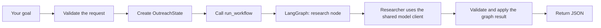

# Outreach Agent File Guide

This guide explains the files and common code patterns in the application through phase four, including phase 3.5.

The key distinction is: **schemas define the data format, state holds one request's data, the graph controls execution, and the workflow function connects the application to the graph.**

## What we built in each phase

Phases one, two, three, 3.5, and four are complete. Each phase adds a building block for the next one.

### Phase 1: Build the application foundation

We made it possible to submit a goal and receive a separate record for that request.

- Set up the Python project, its packages, and the application folders.
- Created `POST /outreach` to accept the user's goal. It trims surrounding whitespace and rejects missing, blank, incorrectly typed, extra, or overly long input.
- Created `OutreachState` to hold the goal, empty result collections, and progress. Every request gets its own collections.
- Added `run_workflow`, the coordinator that changes progress from `initialized` to `skeleton_ready` and returns the state.
- Connected the endpoint to the coordinator and documented installation, startup, example requests, and testing.

The main files were `app/main.py`, `app/api/outreach.py`, `app/models/schemas.py`, `app/orchestration/state.py`, `app/orchestration/workflow.py`, and `pyproject.toml`. We also added package files, tests, and setup documentation.

**What worked after this phase:** submitting a valid goal returned that goal, empty results, and `skeleton_ready`. Verification included 44 passing tests, a fresh installation, a live request, and the API documentation page.

### Phase 2: Give results a consistent format

We defined what each future agent's result should contain so the next agent can understand it.

- Added `Prospect`, `Qualification`, `OutreachStrategy`, `EmailDraft`, and `ReviewResult` in `app/models/schemas.py`.
- Defined rules for required text, scores, decisions, optional company details, and unexpected fields.
- Updated `app/orchestration/state.py` to hold these records. Added `qualification_results` to retain scores and reasons alongside the selected prospects.
- Updated tests to check the new formats, separate collections, and conversion to and from JSON, the text format used in API responses.
- Checked that API responses and generated documentation included the new formats.

The main work was in `schemas.py`, `state.py`, `tests/conftest.py`, and the schema, state, workflow, and API tests. Existing files were expanded rather than creating a second application.

**What worked after this phase:** the application had clear formats for company details, qualification decisions, strategies, drafts, and reviews. Future agents will produce those records. The full suite reached 119 passing tests.

### Phase 3: Add one shared way to call a model

We gave future agents a common function for asking a model to return a particular kind of record.

- Created `app/models/client.py` with `generate_structured`. It receives instructions, input text, the expected record class, and a client, then returns a validated record.
- Added `FakeModelClient`, which returns preset responses in order and records each call for tests.
- Added `OpenAIModelClient`, which handles real model requests in one place and reads explicitly configured credentials and a model name.
- Added clear errors for failed requests, missing or invalid output, incomplete responses, and refusals. Added connection cleanup for the real client.
- Created `tests/test_client.py` to check the fake and the real SDK using responses supplied locally.
- Added the OpenAI package to `pyproject.toml`, optional settings to `.env.example`, and rules in `.gitignore` to exclude local credential files. Updated the README with usage examples.

**What worked after this phase:** future agents can request validated records through a real client or a fake. The full suite reached 166 passing tests, and the README's fake-client example was checked. No live model calls were needed.

### Phase 3.5: Let LangGraph run the existing workflow

We moved the existing initialization step into LangGraph, the library that now controls the order of workflow steps. The execution path is `START → initialize → END`.

- Added LangGraph to `pyproject.toml` and installed it in the project's environment.
- Created `app/orchestration/graph.py` using the existing `OutreachState`. Its initialize node returns only `{"current_step": "skeleton_ready"}`. The graph keeps the goal and existing results.
- Updated `run_workflow(state)` in `app/orchestration/workflow.py` to await the graph, validate its result, and update and return the original record. The endpoint continues calling this same function.
- Created `tests/test_graph.py` and expanded the workflow and API tests to check compilation, execution, preserved information, separate requests, graph delegation, and errors.
- Updated the README, plan, and this guide with the new execution path. The state model, domain records, model client, and FastAPI endpoint stayed compatible.

**What worked after this phase:** `POST /outreach` now runs through LangGraph and still returns the accepted goal, empty results, and `skeleton_ready`. All 166 original tests passed before the change. Afterward, the 35 focused tests and the full suite of 179 tests passed without external services. Installation and the dependency check succeeded. A live server returned `200` for a valid goal, `422` for a blank goal, and `200` for `/docs` without OpenAI credentials.

The graph is compiled once, but each invocation has its own request state. This phase adds no research, qualification, memory, writing, review, Gmail actions, checkpointing, interrupts, subgraphs, or model routing. Those remain later steps.

### Phase 4: Turn supplied research material into prospect records

We added a researcher and connected it to LangGraph. The graph now runs `START → research → END`.

- Created `app/agents/researcher.py`. `Researcher.research` receives a goal and material, asks the existing model client for structured output, and returns `Prospect` records.
- Created `app/prompts/researcher.py` with instructions to use supplied evidence, preserve references, leave unknown details empty, and support different outreach goals.
- Added `ResearchResult` to `schemas.py` as a wrapper around the existing prospect list. Added the optional request field `research_material` without changing the existing prospect fields.
- Created `app/orchestration/nodes/research.py`. Its node adapts state to the researcher and returns partial updates. Its `ResearchContext` holds the researcher and material for just that invocation.
- Updated `graph.py`, `workflow.py`, and the progress labels in `state.py`. The successful status is now `research_complete`; the earlier labels remain valid for existing records.
- Updated the endpoint to accept material and provide an injectable client. It closes clients it creates and reports missing configuration or model failures as HTTP errors.
- Added researcher and node tests, expanded graph, workflow, API, and SDK tests, and added comments and these explanations.

**What worked after this phase:** a goal and supplied material can pass through the real graph and produce typed prospects using a fake or real model client. All 179 baseline tests passed before changes. Afterward, 136 focused tests and the full suite of 233 tests passed without external-service calls. The dependency check passed. A live server accepted a goal with `200`, rejected a blank goal with `422`, reported missing model settings with `503` when material was supplied, and served `/docs` with `200`.

Both README fake-client examples were run successfully, including the complete graph example returning an academic prospect with its supplied source. The fake examples check the program's behavior and do not perform actual research. The researcher checks names and source references against the supplied text, but does not verify websites or prove every statement's accuracy. Search, qualification, writing, reviews, memory, approvals, and Gmail remain later work.

### Documentation updates between phases

After phase two, we added comments and explanations to help you read the code, then collected the file explanations in this guide. Phase three added the model-client explanations. We later added `AGENTS.md` to instruct coding assistants to keep this guide updated alongside the code. Phase 3.5 adds graph explanations and updates the phase history to reflect the new orchestration choice.

### Next: Phase 5, the search tool

Phase five is planned. It will give the researcher an injectable search tool that returns typed results with source references. Qualification follows in phase six, and conditional routing in phase seven.

At present, `POST /outreach` returns `research_complete`. With supplied material and a configured client it can return prospects. A goal alone has no evidence to research and returns empty prospects without a model call.

## How a request moves through the application

When you submit a goal, this happens:

FastAPI uses the rules in `schemas.py` to check the request. The endpoint creates a fresh state and waits for `run_workflow`. That function runs the graph and returns its result as an `OutreachState`, which the endpoint returns as JSON.

The application currently researches supplied material and returns structured prospects. The research component uses phase three's shared model client. Qualification and email-writing components will be added later.

## The application files

| File | Phase work | What it does |
|---|---|---|
| [app/main.py](app/main.py) | Phase 1: application setup | Creates the FastAPI application and connects its endpoints. Uvicorn loads this application when you start the server. |
| [app/api/outreach.py](app/api/outreach.py) | Phase 1: request handling; phase 4: supplied material and client dependency | Receives the validated goal and optional material, creates a fresh state, calls the workflow, and returns its result. Provides and closes a real client for requests with evidence. |
| [app/models/schemas.py](app/models/schemas.py) | Phase 1: goal rules; phase 2: five result formats; phase 4: research input and batch | Defines what information each record contains and checks that incoming data follows those rules. |
| [app/models/client.py](app/models/client.py) | Phase 3: shared model calls | Provides one function for requesting structured model output, validates the result, and supplies real and fake clients. |
| [app/agents/researcher.py](app/agents/researcher.py) | Phase 4: research component | Requests a batch of prospects through the existing model client and checks distinct IDs, names, and source references. |
| [app/prompts/researcher.py](app/prompts/researcher.py) | Phase 4: research instructions | Explains the research task to the model, including evidence rules and which later-stage tasks to leave alone. |
| [app/orchestration/nodes/research.py](app/orchestration/nodes/research.py) | Phase 4: graph adapter | Holds per-request context, calls the researcher with the goal and material, and returns only research-related updates. |
| [app/orchestration/state.py](app/orchestration/state.py) | Phases 1–2: request and results; phase 4: progress label | Holds one request's goal, progress, and results together. Each request gets its own state. |
| [app/orchestration/graph.py](app/orchestration/graph.py) | Phase 3.5: graph engine; phase 4: research path | Builds and compiles `START → research → END` using the existing state and per-request context. |
| [app/orchestration/workflow.py](app/orchestration/workflow.py) | Phase 1: coordinator; phase 3.5: graph connection; phase 4: injected research inputs | Keeps `run_workflow(state)` available and accepts optional researcher and material arguments. Validates the graph result and updates and returns the supplied record. |

## How graph.py and workflow.py work together

A graph is a set of steps connected by paths. A **node** performs one step; an **edge** says which step follows it. Our graph currently has one node, `research`, between the start and finish.

| Name | What it receives | What it produces |
|---|---|---|
| `research` in `nodes/research.py` | The current `OutreachState` and a runtime object containing request context | A dictionary updating progress to `research_complete` and, when material was supplied, replacing the prospect list. |
| `build_graph` in `graph.py` | No arguments | A compiled graph ready to execute `START → research → END`. Compiling prepares the path; it does not run outreach. |
| `outreach_graph` in `graph.py` | This is the saved compiled graph, rather than another function. | A reusable execution path. Each call to its `ainvoke` method processes one supplied state. |
| `run_workflow` in `workflow.py` | One request's `OutreachState`, plus an optional researcher and material | The same record, updated with the graph's validated result. |

LangGraph returns its result as a dictionary, so `run_workflow` first checks it with `OutreachState.model_validate`. It then copies each validated field into the original record. A failed invocation or invalid result raises an error before this copying begins.

The graph controls execution. The researcher performs research, and the existing model client handles its model request. Qualification and writing components remain later work.

## How the researcher works

`Researcher(client=...)` receives a real or fake client from its caller. Its `research` method receives a goal and `research_material`, validates those inputs using the request rules, and requests one `ResearchResult` through `generate_structured`. It returns the wrapper's list of `Prospect` records.

For example, notes might name Example University, Professor Ada Lin, wearable AI research, and `https://example.com/lab` as the source. The resulting prospect can store that organization, person, signal, and reference. Unknown website or industry information stays empty.

The component checks that IDs are distinct, names appear in the material without regard to capitalization, and source references occur in the material. The prompt requests supported facts and keeps instructions inside the material separate from the research task. These checks do not prove every claim is true or that a prospect fits the goal; later qualification, review, and evaluation steps will add their own checks.

Blank material returns an empty list without a model call. When the node receives no new material, it leaves existing prospects in state intact and updates only progress. If new material produces no matches, it replaces the prospect list with an empty list.

`ResearchContext` keeps the researcher and material outside `OutreachState`. LangGraph passes it to the node for that invocation, so concurrent requests can use different clients and evidence without sharing them.

## How the API provides a model client

`get_research_client` in `app/api/outreach.py` is a FastAPI dependency: a helper FastAPI calls to supply the endpoint with a client. It receives the validated request. With blank material, it supplies `None`. With material, it creates `OpenAIModelClient` from exported settings and closes it after success or failure.

Tests replace this helper through `app.dependency_overrides` and supply a `FakeModelClient`. Missing settings return `503`; failed requests, refusals, invalid output, and failed evidence checks return `502`. Invalid request input continues to return `422` before client creation.

## The records inside schemas.py

Each class represents a different kind of record:

| Class | Meaning |
|---|---|
| `OutreachRequest` | The user's required goal and optional text containing research material. |
| `Prospect` | A potential outreach target, represented by an organization, optional person details, useful signals, and source references. |
| `ResearchResult` | The model's research response: a wrapper containing a list of existing prospect records. |
| `Qualification` | A prospect's score, selection decision, and reasons. |
| `OutreachStrategy` | Why to contact the prospect, how the product could help, and what action to suggest. |
| `EmailDraft` | The email subject and body for a prospect. |
| `ReviewResult` | The reviewer's decision, score, and feedback about a draft. |

These classes **store and validate information**. The researcher now produces prospects. The qualifier, writer, and reviewer will produce their results in later phases.

For example, a prospect might have ID `"p1"`. Its qualification, strategy, draft, and review all use `prospect_id="p1"` to refer to that company.

## The model client inside client.py

Think of `generate_structured` as the common place where an agent asks for a record. It needs four arguments:

| Argument | Meaning |
|---|---|
| `instructions` | Explain the task the model should perform. |
| `input_text` | Provide the goal, company notes, or other information to process. |
| `response_model` | Specify the expected format, such as the `Qualification` class. |
| `client` | Supply the object that produces a response: a real provider or a fake for tests. |

For example, passing `response_model=Qualification` means the function must return a valid qualification record. It checks fields such as the prospect ID, score, and decision before returning the result.

The file contains these supporting pieces:

| Name | Meaning |
|---|---|
| `ModelClient` | Describes the method any client must provide. A replacement client can follow this description without inheriting from it. |
| `FakeModelClient` | Returns responses you supplied in advance, in order. It does not analyze the input or contact a model. |
| `ModelCall` | Records the instructions, input, and requested record class passed to the fake. Tests inspect `client.calls` to check these details. |
| `OpenAIModelClient` | Makes a real OpenAI request and obtains structured output. It reads explicitly exported settings when created with `from_env()`. |
| `ModelClientError` | The common exception for a failed model call. |
| `ModelResponseError` | Reports missing, incomplete, or invalid output. It is a kind of `ModelClientError`. |
| `ModelRefusalError` | Reports that the model refused the request. It is a kind of `ModelResponseError`. |

The shared function checks output from both clients against the same record rules. This lets future agents use a fake during tests and a real client when running with configured credentials. The README includes an example you can run using the fake.

## Installation and documentation files

| File | Meaning |
|---|---|
| [AGENTS.md](AGENTS.md) | Gives coding assistants the project's documentation instructions, including updating this guide whenever the code changes. |
| [pyproject.toml](pyproject.toml) | Lists the project's required packages, supported Python version, installation settings, and test settings. |
| [.env.example](.env.example) | Lists the optional `OPENAI_API_KEY` and `OPENAI_MODEL` settings with empty values. Copy it locally and export the completed settings before using the real client. |
| [.gitignore](.gitignore) | Tells Git to ignore installed packages, generated files, and local credential files such as `.env`. |
| [README.md](README.md) | Instructions for installing, starting, testing, and understanding the application. |
| [plan.md](plan.md) | Records the development phases, completed work, and next step. |
| [FILE_GUIDE.md](FILE_GUIDE.md) | This explanation of the project's files and code patterns. |

## The __init__.py files

The `__init__.py` files organize the Python packages:

- [app/__init__.py](app/__init__.py): the overall application package.
- [app/api/__init__.py](app/api/__init__.py): the endpoint package.
- [app/agents/__init__.py](app/agents/__init__.py): components that use model reasoning.
- [app/prompts/__init__.py](app/prompts/__init__.py): instructions for those components.
- [app/models/__init__.py](app/models/__init__.py): the structured records and model-client package.
- [app/orchestration/__init__.py](app/orchestration/__init__.py): the state and workflow package.
- [app/orchestration/nodes/__init__.py](app/orchestration/nodes/__init__.py): adapters between components and graph state.

These files make it possible to organize imports using package paths such as `app.models.schemas`.

## The test files

The test files check that the application behaves correctly:

| File | What it checks or provides |
|---|---|
| [tests/conftest.py](tests/conftest.py) | Fresh example records shared by tests. These are sample companies and contacts. |
| [tests/test_schemas.py](tests/test_schemas.py) | Required fields, valid text, score limits, decisions, and JSON conversion. |
| [tests/test_client.py](tests/test_client.py) | Preset model responses, output validation, provider requests and failures, and connection cleanup. Every HTTP response in these tests is simulated locally. |
| [tests/test_state.py](tests/test_state.py) | Correct starting state and independent data for separate requests. |
| [tests/test_researcher.py](tests/test_researcher.py) | Phase 4: typed prospects, different goal examples, missing material, input and output validation, evidence checks, duplicate IDs, and model failures. |
| [tests/test_research_node.py](tests/test_research_node.py) | Phase 4: passing inputs to the researcher, returning only research updates, and propagating failures without changing the input state. |
| [tests/test_graph.py](tests/test_graph.py) | Graph compilation, execution order, progress, preserved records, and separate requests; phase 4 adds researcher execution and distinct per-request contexts. |
| [tests/test_workflow.py](tests/test_workflow.py) | Progress and preserved information from earlier phases; phase 3.5 adds graph delegation, typed output, original-record behavior, and errors. |
| [tests/test_outreach_api.py](tests/test_outreach_api.py) | The request/response flow and API documentation; phase 4 adds supplied material, injected clients, input checks, model errors, and client cleanup. |

The tests run locally without calling external services. Tests that need to inspect the workflow can temporarily replace it with a fake function.

## Common code patterns

| Code | Plain-language meaning |
|---|---|
| `from ... import ...` | Bring a class or function from another module into this file. |
| `class Prospect(BaseModel)` | Define a structured record whose incoming data Pydantic validates. |
| `goal: GoalText` | A field named `goal` that follows the goal-validation rules. |
| `Annotated[str, ...]` | Combine the text type with extra validation rules. |
| `ConfigDict(extra="forbid")` | Reject fields the record does not recognize. |
| `list[Prospect]` | A list of prospect records. |
| `dict[str, EmailDraft]` | Drafts organized under text keys, such as `"p1"`. |
| `Field(default_factory=list)` | Give every new record its own empty list. |
| `Field(default_factory=dict)` | Give every new record its own empty dictionary. |
| `NonEmptyText \| None = None` | This information can be unknown or omitted. |
| `Literal["initialized", "skeleton_ready", "research_complete"]` | Describe the allowed progress labels, keeping the earlier foundation label valid. |
| `async def` / `await` | Define an asynchronous function and wait for its result. The endpoint waits for the workflow before returning a response. |
| `model_dump()` / `model_dump_json()` | Convert a record into a Python dictionary or JSON text, respectively. |
| `model_validate()` / `model_validate_json()` | Check a dictionary or JSON text and turn it into a validated record. |
| `StateGraph(OutreachState)` | Define a workflow using the same record format as the application. |
| `add_node` / `add_edge` | Add a named step and connect it to the next step. |
| `builder.compile()` | Prepare the graph so it can execute its connected steps. |
| `await outreach_graph.ainvoke(state)` | Run the graph asynchronously for this request and wait for its result. |
| `context=ResearchContext(...)` | Supply a researcher and material for this invocation without putting them into the result record. |
| `Runtime[ResearchContext]` | The object LangGraph supplies to a node so it can read the invocation's context. |
| `Depends(get_research_client)` | Ask FastAPI to provide the endpoint with the client returned by this helper. |
| `yield ready_client` | Give the endpoint a client while keeping the surrounding cleanup context active. |
| `for field in OutreachState.model_fields` | Visit each field defined by the state model. The workflow copies its validated value into the original record. |
| `Protocol` | Describe the methods an interchangeable object must have. Here it allows real and fake clients to share an interface. |
| `TypeVar(..., bound=BaseModel)` | Keep track of which record type was requested, so the function's return type matches it. |
| `async with` | Use an asynchronous resource and clean it up when the block ends. The real client closes the SDK connection it owns. |
| `raise ModelResponseError(...) from error` | Report a clear model-output failure while keeping the original error available for debugging. |
| `@pytest.fixture` | Define example data or a helper that pytest supplies to tests requesting it by name. |
| `@pytest.mark.parametrize` | Run one test with several different examples. |
| `assert` | Check an expectation; a mismatch fails the test. |

## Suggested reading order

Start reading `app/api/outreach.py`, then follow its calls into `app/orchestration/state.py` and `app/orchestration/workflow.py`. Read `app/orchestration/graph.py` to see which step the workflow runs. Keep `app/models/schemas.py` open beside them to understand the records they use.

Read `app/main.py` to see how the endpoint is connected to the web application. Then read the corresponding test files to see examples of valid input, invalid input, and expected results.

For phase three, read `generate_structured` in `app/models/client.py` first, then `FakeModelClient`, then `OpenAIModelClient`. Read `tests/test_client.py` alongside them to see how a fake response becomes a validated record and how real SDK behavior can be tested locally.

For the graph added in phase 3.5 and expanded in phase four, read `build_graph` in `graph.py`, the `research` node, and then `run_workflow` in `workflow.py`. The graph tests show the execution path; the workflow and API tests show how the rest of the application uses it.

For phase four's reasoning component, read the instructions in `app/prompts/researcher.py`, then `Researcher.research` in `app/agents/researcher.py`. Compare them with the fake-client examples in `tests/test_researcher.py` and the README.

## Keeping this guide current

This guide is updated together with the code in each phase. When a file or function changes, its explanation should describe what it does, why it is needed, what information it receives, and what it returns. New explanations use plain language and small examples where helpful. Planned features are identified as future work so you can tell what already works.

For every completed phase, update the phase history above with what was built, which files changed, what became possible, and how it was checked.
