# Outreach Agent

[](LICENSE)
[](CONTRIBUTING.md)

A Telegram assistant that researches the web, reads documents, and prepares Gmail drafts when asked. You approve changes to existing drafts and send emails yourself.

**Python · LangGraph · FastAPI · Grok · PostgreSQL / SQLite · Playwright**



## Use it

| Say or upload | Get |
|---|---|
| “Find funded wearable startups” | Research with sources; keyless web search works by default. |
| A PDF, image, or document | Extracted text, summaries, and cited findings. |
| “Draft a test email to friend@example.com” | A reviewed Gmail draft. |
| “Edit my latest draft” | A preview; approval updates the same draft. |

Say **stop** and **continue** to resume saved work. The dashboard shows runs, approvals, connections, and usage. Optional pgvector search finds saved documents by meaning.

## Try the demo

```bash
python3.12 -m venv .venv
source .venv/bin/activate
python -m pip install -e '.[dev]'
python -m app.main --demo
```

Open **http://127.0.0.1:8000**, sign in with **`demo`** (or your configured owner password), and choose **New run**. External services are simulated. To connect your own Telegram and Gmail, follow [Setup](docs/SETUP.md).

## Check the project

```bash
python -m pytest
python -m evals.run --output .data/evaluations.json
```

These checks use fake external services. See [validation results](docs/VALIDATION.md).

## Find the right guide

| Need | Guide |
|---|---|
| Install, connect accounts, use the bot | [Setup](docs/SETUP.md) |
| Understand models and tool calls | [Models and tools](docs/MODELS_AND_TOOLS.md) |
| Navigate the code and phases | [File guide](FILE_GUIDE.md) |
| Configure cloud storage and saved search | [Supabase](docs/SUPABASE.md) |
| Integrate or contribute | [API](docs/API_GUIDE.md) · [Contributing](CONTRIBUTING.md) |

Open source under [MIT](LICENSE). Contributions use the same license; contributors retain copyright. [Third-party notices](THIRD_PARTY_NOTICES.md).
