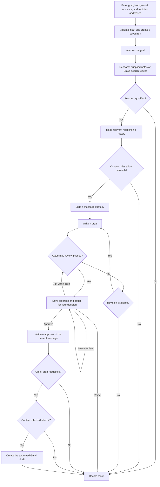
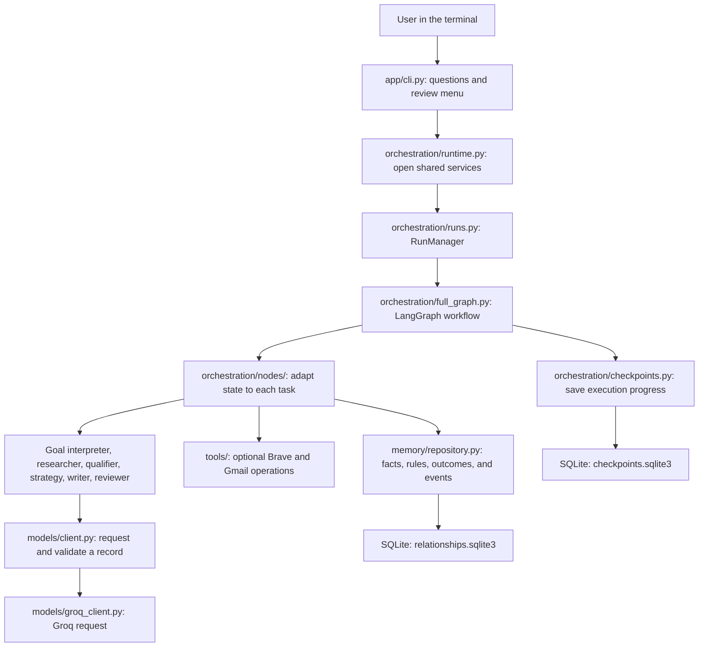

# Outreach Agent

A Python outreach assistant that turns a goal and supporting research into email drafts you can review. It finds and scores prospects, checks relationship history, writes a message, and pauses for your decision before creating a Gmail draft.

**V1 runs in the terminal, uses Groq for model calls, and saves data locally with SQLite.** It supports academic, job, sales, networking, and collaboration goals. A working offline demo lets reviewers explore the entire path without credentials.

## The problem this project addresses

Preparing outreach usually means collecting evidence, deciding whom to contact, remembering earlier conversations, and writing a relevant message. Keeping those steps together helps a user understand why a prospect was selected and what supports a draft.

This project connects those steps in one saved workflow. For example:

> Find professors studying AI observability for PhD outreach.

The user supplies their background, research notes or a search choice, and known recipient addresses. The application produces prospects, qualification reasons, message strategies, and reviewed drafts. The user can approve, reject, edit, or leave the work paused and return later.

## What a reviewer can try

The interactive demo uses fictional data and fake tools. It exercises the real workflow without making model, search, or Gmail requests.

```bash
python3.12 -m venv .venv
source .venv/bin/activate
python -m pip install -e '.[dev]'
python -m app.cli --demo
```

Use Python **3.12 or newer**, and run these commands from the project folder. The virtual environment keeps dependencies separate from other projects. Installation downloads the required packages; the demo itself calls no external services.

In the menu:

1. Choose **1** to start the fictional PhD outreach example.
2. Observe `awaiting_approval`, the selected prospect, and the draft.
3. Choose **4** to review. Press Enter to use the latest run ID.
4. Type **approve**, **reject**, **edit**, or **later**. Approval records a fake Gmail draft; editing requires another review and a fresh decision.
5. Choose **2** to list runs or **6** to inspect execution events.

Demo records disappear on exit. Normal runs use the local SQLite files and survive restarting. After installation, `outreach` is a shortcut for `python -m app.cli`.

## How the outreach workflow works

A prospect is a person or organization that may fit your goal. Each prospect follows this decision path; a run can contain several prospects, and blocked or failed prospects are recorded separately.



Model-backed tasks interpret goals, research evidence, score relevance, and propose messages. Python rules enforce the qualification threshold, contact restrictions, revision allowance, and approval requirements. The initial qualification threshold is **70 out of 100**. The revision allowance is **one**, shared by automatic rewrites and human edits.

Contact checks cover opt-outs, active conversations, recent outreach, future reconnect dates, missing recipient addresses, and pending external actions. An edit invalidates the old approval. If a review cannot pass within the allowance, the prospect receives a `manual_review` outcome.

A completed run means processing ended. Inspect each prospect's outcome: it may be approved, drafted, rejected, blocked, failed, or awaiting manual review.

## How the code connects

A record is a validated collection of fields. A graph is the sequence of workflow steps and decisions. A checkpoint is saved progress for one execution.



Read the implementation in this order:

| File or folder | Responsibility | What it gives the next step |
|---|---|---|
| [app/cli.py](app/cli.py) | Collect answers and display results; submit the user's current draft decision. | A validated request or approval submission. |
| [app/models/workflow.py](app/models/workflow.py) | Define the complete request, goal, memory, approval, and state formats. | Consistent fields shared across the workflow. |
| [app/orchestration/runtime.py](app/orchestration/runtime.py) | Open the database, checkpoint storage, and optional tools; close connections on exit. | A ready workflow manager. |
| [app/orchestration/runs.py](app/orchestration/runs.py) | Start, inspect, resume, or retry the same identified execution. | A run response with progress, results, and errors. |
| [app/orchestration/full_graph.py](app/orchestration/full_graph.py) | Connect research and message-preparation steps, revision loops, and the human pause. | Updated state and the next step to execute. |
| [app/orchestration/nodes](app/orchestration/nodes) | Read state, call the relevant component, and return partial updates. | Results attached to the correct prospect. |
| [app/agents](app/agents), [qualification](app/qualification), [strategy](app/strategy), and [prompts](app/prompts) | Perform individual model-backed tasks using supplied evidence and context. | Validated goal, prospect, qualification, strategy, draft, or review records. |
| [app/models/client.py](app/models/client.py) and [groq_client.py](app/models/groq_client.py) | Provide one model interface, validate output, and handle provider requests. | A record that matches the requested format. |
| [app/security](app/security) | Apply contact rules and limits in code. | Explicit permission to proceed or reasons to stop. |
| [app/memory](app/memory) and [db](app/db) | Retrieve and store sourced relationship information and action/run records. | Context for this run and later goals. |
| [app/orchestration/checkpoints.py](app/orchestration/checkpoints.py) | Save and restore workflow execution progress. | The ability to resume a paused run after restart. |
| [app/tools](app/tools) | Keep search and Gmail requests behind replaceable interfaces. | Source results or the recorded result of an external action. |

The CLI calls `RunManager` directly; it needs no API server. The optional FastAPI application uses the same runtime and manager. The earlier research-only `POST /outreach` endpoint keeps its original coordinator in [workflow.py](app/orchestration/workflow.py); the complete CLI path uses `RunManager` and `full_graph.py`.

For a worked example, the CLI builds a request, the manager creates a fresh state and run ID, and the graph runs research and qualification. Eligible prospects reach writing and review. The graph then saves a checkpoint and pauses. When you approve later, the manager resumes that execution using the saved draft version and content. Research is not repeated just to approve the message.

## Database: SQLite for V1

**Both V1 storage files use SQLite. PostgreSQL is an optional alternative.** SQLite stores information in local files, so V1 needs no database account, password, API key, or separately running database server.

| Local file | What it remembers | Why it is separate |
|---|---|---|
| `.data/relationships.sqlite3` | Contacts, source-backed facts, contact rules, interactions, outcomes, run summaries, action records, counters, and execution events. | This information can help future outreach goals. |
| `.data/checkpoints.sqlite3` | Workflow state and saved execution progress. | A checkpoint resumes one particular run, such as a paused approval. |

SQLAlchemy is the Python library used to read and write relationship records. LangGraph's SQLite checkpointer saves execution progress. The normal runtime creates these files automatically. The demo uses temporary memory-only storage.

The default settings are configuration values, not API keys:

```dotenv
OUTREACH_DATA_DIR=.data
OUTREACH_DATABASE_URL=
OUTREACH_CHECKPOINT_BACKEND=sqlite
OUTREACH_CHECKPOINT_POSTGRES_URL=
```

`.data` is relative to the folder where you start the application. Run from the project folder to keep using the same files. Blank database URLs select local defaults; the blank PostgreSQL checkpoint URL is unused in SQLite mode. [Optional PostgreSQL setup](docs/API_GUIDE.md#search-gmail-postgresql-and-operating-settings) is available for a later deployment. It has not been verified against a live PostgreSQL server.

## Groq setup and the keys you need

Only the selected model key is needed for a real run with supplied research notes. Search and Gmail are optional.

| Setting | Purpose | Needed for |
|---|---|---|
| `OUTREACH_MODEL_PROVIDER=groq` | Select the model provider. | Your Groq setup; it is not a secret. |
| `GROQ_API_KEY` | Authenticate model requests. | Real goal interpretation, research, qualification, writing, review, and ordinary reply processing. |
| `GROQ_MODEL` | Select a Groq-hosted model. | Defaults to `openai/gpt-oss-120b`; it is not a secret. |
| `BRAVE_SEARCH_API_KEY` | Authenticate web search. | Choosing search instead of, or alongside, supplied notes. |
| `GMAIL_ACCESS_TOKEN` | Authorize Gmail reads and writes through Google OAuth. | Optional email-history reading or approved Gmail drafts. |
| `OUTREACH_API_KEY` | Protect the optional HTTP API. | Shared API access; the local CLI does not need it. |

Get model credentials from the [Groq console](https://console.groq.com/keys) and search credentials through [Brave Search API](https://brave.com/search/api/). The `openai/` prefix in the example model name does not change the provider: requests go to Groq using your Groq key. Select a model supporting [Groq Structured Outputs](https://console.groq.com/docs/structured-outputs). The adapter uses best-effort JSON schema with local record validation.

From the project folder, copy the template without overwriting an existing `.env`:

```bash
cp -n .env.example .env
```

Edit `.env` locally. Fill `GROQ_API_KEY`, keep `OUTREACH_MODEL_PROVIDER=groq`, and add optional keys only for features you intend to use. Then load the settings into your terminal and start the CLI:

```bash
source .venv/bin/activate
set -a
source .env
set +a
python -m app.cli --check-config
python -m app.cli
```

`--check-config` reports configured/missing settings without printing secrets or contacting providers. It checks presence; a real run confirms provider acceptance. The application does not load `.env` automatically. Existing installations without a provider setting retain the original OpenAI default; set the provider explicitly for Groq.

Choose **1** and enter your goal, background, evidence, and recipient addresses. Recipient mappings use the exact target display name from the evidence or a known prospect ID. Automatic email-address discovery is not included. Choose `none` to record an approved result without Gmail, or `draft` to create an approved Gmail draft. Choose **4** to review a paused run; the CLI submits the current draft's IDs and version for you. Choosing `later` submits no decisions for that batch.

For Gmail, obtain an OAuth access token with the relevant permissions using [Google's authorization setup](https://developers.google.com/workspace/gmail/api/auth/web-server). Set `OUTREACH_READ_GMAIL=true` only when you want history ingestion. Tokens currently need manual renewal; automated OAuth login/refresh is not implemented. Sending is disabled by default, and starting a CLI run offers `none` or `draft`. Advanced settings and the guarded API sending capability are explained in the [integration guide](docs/API_GUIDE.md).

## Engineering decisions and their value

These decisions make the workflow inspectable and easier to extend. Each claim has an implementation a reviewer can read.

| Decision demonstrated | Evidence in the repository | Practical value for a team |
|---|---|---|
| Validate each task's output against shared records. | [Schemas](app/models/schemas.py), [workflow records](app/models/workflow.py), [shared client](app/models/client.py). | Components exchange predictable data and reject malformed output before later steps use it. |
| Make routing and contact policy explicit Python rules. | [Routing](app/orchestration/routing.py), [contact policy](app/security/contact_policy.py). | Reviewers can inspect why a prospect proceeds or stops. |
| Save progress and require approval of current content. | [Checkpoints](app/orchestration/checkpoints.py), [approval node](app/orchestration/nodes/approval.py), [CLI tests](tests/test_cli.py). | Long workflows can resume; changing a draft requires a new decision. |
| Store facts with literal supporting quotes and sources. | [Extraction](app/memory/extraction.py), [retrieval](app/memory/retrieval.py). | Relationship context remains traceable to the message that supplied it. |
| Claim external actions before network writes and retain uncertain results. | [External-action node](app/orchestration/nodes/external.py), [repository](app/memory/repository.py). | Repeated or interrupted requests can be inspected without blindly repeating Gmail writes. |
| Centralize attempt limits, timeouts, and estimated budgets. | [Limits](app/security/limits.py), [managed calls](app/orchestration/context.py). | Resource use and recovery behavior are configurable and visible. |
| Replace external clients in tests and keep evaluation reports separate. | [Tests](tests), [evaluation cases](evals/cases.json), [scoring](evals/scoring.py). | The workflow can be tested without account credentials, and model changes can be compared against examples. |

The project demonstrates building an AI feature as a usable application: input validation, orchestration, persistence, human decisions, failure handling, and verification all connect through the same path. The intended user benefit is less repeated research and more context-aware draft preparation. No user-time savings, response-rate improvements, or production-scale performance have been measured yet.

## Tests and evaluations

The current automated suite has **360 tests**, covering input validation, provider adapters, routing, contact rules, revisions, approval, duplicate/uncertain actions, replies, SQLite restart/resume, cancellation recovery, and the CLI. Normal tests use fake clients or locally supplied HTTP responses, with isolated settings and temporary data.

```bash
python -m pytest -q
```

Evaluations compare outputs with reference examples. Four starter cases cover academic, job, sales, and networking goals. The local command exercises the scoring and workflow with preset responses:

```bash
python -m evals.run --output .data/evaluations.json
```

To measure your configured Groq model on those examples after loading `.env`:

```bash
OUTREACH_READ_GMAIL=false python -m evals.run --live --output .data/groq-evaluations.json
```

Live evaluation uses model credits, supplied fictional evidence, and no Gmail actions. Automated scores check reference targets, source retention, selected prospects, message constraints, and workflow rules. Factual accuracy and tone also need human assessment. Passing the simulation establishes that its code and scoring work; real model quality remains to be measured on representative goals.

## Current scope and next work

| Area | Current state |
|---|---|
| CLI and complete workflow | Implemented and checked locally, including human decisions and restart/resume. |
| SQLite | Default V1 storage; local persistence is exercised by tests. |
| Groq, OpenAI, Brave, and Gmail adapters | Implemented and checked with local responses/fakes. Live account integration checks are still needed. |
| Optional API and inbound reply handling | Implemented. Replies can update memory and contact rules; follow-up emails are not created automatically. |
| Email sending | Guarded code exists in the API path and is disabled by default. It has not sent mail to a live account. |
| PostgreSQL | Optional packages and portable definitions exist; live server verification is pending. |
| Web UI, Telegram, WhatsApp | Deferred beyond the CLI V1. |
| Model routing, concurrent work, semantic retrieval | Optional capabilities with conservative defaults or measurement requirements; no production model optimization or vector database has been selected. |

The next practical work is to configure real accounts, try representative CLI goals, inspect failures and draft quality, and expand the evaluation cases. Initial table creation is provided; future database changes need explicit migrations. Estimated cost reservations are configurable estimates rather than exact billing caps. The optional API serves one configured account; multi-user isolation and a shared rate limiter for multiple server workers are additional deployment work.

For more detail, read [FILE_GUIDE.md](FILE_GUIDE.md) for every file and phase, [plan.md](plan.md) for the implementation record, and [docs/API_GUIDE.md](docs/API_GUIDE.md) for API requests, reply ingestion, provider alternatives, and advanced settings.

## Contributing and license

Contributions are welcome, including documentation improvements, bug fixes, tests, and evaluation cases. Read [CONTRIBUTING.md](CONTRIBUTING.md) for local setup, checks, pull requests, and contribution licensing.

The project is released under the [MIT License](LICENSE). It permits use, modification, redistribution, and commercial use while requiring preservation of its copyright and license notices. Contributions are accepted under the same license, and contributors retain their copyright. Dependencies, model services, and Gmail retain their own licenses and terms. See [GitHub's MIT overview](https://choosealicense.com/licenses/mit/) for a plain-language explanation.
