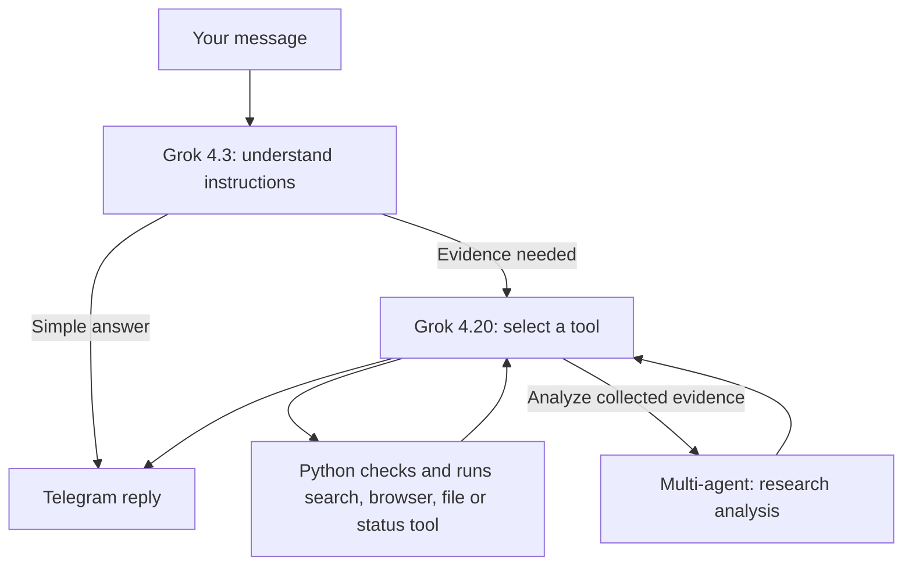

# Models and tool calls

With xAI selected, the app uses one API key and three roles. A role is simply a job assigned to a model. The app chooses the role; the model cannot change its own permissions or spending limits.

| Role | Default model | Work |
|---|---|---|
| Instruction following | `grok-4.3` | Understand the message, interpret outreach goals, write emails. A greeting can finish here. |
| Reasoning | `grok-4.20-0309-reasoning` | Select conversation tools, answer from their results, qualify prospects, plan strategy, review drafts, interpret relationship history. |
| Research | `grok-4.20-multi-agent-0309` | Analyze collected evidence and turn research material into sourced prospects. Uses `low`, the four-agent setting. |



`search` discovers pages with Brave. `read_page` uses the protected public browser. `read_file` reads an attached document's extracted text. `run_status` reads outreach progress. `research` asks the multi-agent model to analyze evidence those tools already collected. It does not search by itself. Supplied URLs and files work without Brave; discovering new websites requires the Brave key.

The reasoning model returns a native **function call**: a tool name, arguments, and a call identifier. Python checks the name and arguments, then applies file-access rules, public-network restrictions, cancellation, and budgets. The result is returned as `function_call_output` with that same identifier. Unknown tools, unexpected fields, multiple simultaneous calls, and tools requested after the limit are rejected. Credentials are never tool arguments. Neither sending email nor approving a draft is a conversation tool.

The multi-agent model has no access to our custom functions. Its provider-hosted search and other paid tools are deliberately not enabled: gathering evidence remains inside our existing search/page limits. An analysis is labeled as an analysis, not a quotation from a website. Sources must match collected references, although matching references alone cannot prove every claim is true. Final draft creation stays in the explicit outreach workflow.

## Settings

Add these non-secret settings to your existing `.env`. Keep your existing `XAI_API_KEY` there, once. Restart the service after changes.

```dotenv
OUTREACH_MODEL_PROVIDER=xai
XAI_TASK_ROUTING=true
XAI_INSTRUCTION_MODEL=grok-4.3
XAI_REASONING_MODEL=grok-4.20-0309-reasoning
XAI_RESEARCH_MODEL=grok-4.20-multi-agent-0309
XAI_REASONING_EFFORT=none
```

The effort setting applies to 4.3 only. The reasoning model uses its own reasoning behavior; multi-agent uses `low`. `XAI_MODEL` remains an older fallback for the instruction model. `XAI_TASK_ROUTING=false` restores the previous single-model xAI adapter for troubleshooting. Groq, OpenAI, and the offline demo retain their existing interfaces.

Connections shows the configured roles. Saved `model_start`, `model_end`, and `model_failure` events show the task, role, model, and available usage. `tool_start`, `conversation_tool`, and `tool_failure` connect each local tool attempt to its result using a call ID. Logs omit full prompts and credentials. The usual model/search/page budgets apply and do not increase on retry. The reserved dollar amount remains an estimate, not the provider's bill or an exact cap on its charges; the provider's billing limit is separate. More agents can consume more tokens even in a single request.

## Verification

`tests/test_model_routing.py` uses fake HTTP responses through the real graph. It checks all three role selections, native call/result pairs, researched citations, model usage events, and rejected tool requests. `tests/test_xai_client.py` retains single-model compatibility and provider-error checks. No real API calls are needed.

These routes are owner-selected, not a claim that comparative quality evaluations proved them optimal. A live test still needs account credits and permission for all three models. The old optional measurement-based router remains available to evaluation code.

Provider references: [function calling](https://docs.x.ai/developers/tools/function-calling), [multi-agent restrictions and agent counts](https://docs.x.ai/developers/model-capabilities/text/multi-agent), [4.3](https://docs.x.ai/developers/models/grok-4.3), [4.20 reasoning](https://docs.x.ai/developers/models/grok-4.20-0309-reasoning).
