# Models and tools

One xAI key serves three roles. Python selects the model, validates tool requests, and enforces limits.



## Model settings

These defaults belong in `.env`, alongside your private `XAI_API_KEY`:

```dotenv
OUTREACH_MODEL_PROVIDER=xai
XAI_INSTRUCTION_MODEL=grok-4.3
XAI_REASONING_MODEL=grok-4.20-0309-reasoning
XAI_RESEARCH_MODEL=grok-4.20-multi-agent-0309
```

4.3 understands requests and writes emails. 4.20 selects tools, qualifies contacts, plans strategy, and reviews drafts. Multi-Agent analyzes collected evidence; it has no direct connector access. Greetings can finish with 4.3 alone.

## Available tools

A **tool call** asks Python to perform a specific operation and return its result.

| Tool | What it does |
|---|---|
| `search` | Finds public pages with keyless DuckDuckGo, or Brave when configured. |
| `read_page` | Reads an allowed public website in the browser. |
| `read_file` | Reads text extracted from an attached file. |
| `search_saved` | Finds relevant passages in the enabled saved-knowledge library. |
| `read_gmail_draft` | Reads an existing Gmail draft; several matches require your selection. |
| `run_status` | Reads saved progress, drafts, and outcomes. |
| `research` | Asks Multi-Agent to analyze evidence already collected. |

The latest message defines the task. Fresh research must first search or read its supplied URL; an existing-draft edit must first read Gmail. The reasoner returns a native function call with a name, arguments, and call ID. Python checks it and returns the result under that same ID. Unknown tools and excess calls are rejected.

Website and file content stays evidence. It cannot authorize an email action. Provider-hosted search tools are disabled; research uses the app's bounded connectors. Public search can be rate-limited. Search snippets do not prove a full page was read.

## Email actions



Known recipients go directly to writing and review. Finding new contacts adds research, qualification, and address selection. Contact checks, account checks, and duplicate protection apply to both.

For an existing draft, inspect the preview in Telegram or the dashboard and choose **Approve changes** or **Reject changes**. Approval binds the request, account, draft ID, original message, and proposed content. Changed drafts or accounts block old previews. Recipients, attachments, and thread are preserved. HTML-only or oversized drafts require editing in Gmail. Sending stays manual.

## Saved work and validation

| Need | Where to look |
|---|---|
| Stop and resume | Say **stop**, then **continue**; use `/continue RUN_ID` if several tasks are unfinished. |
| Inspect tool/model activity | Dashboard → run details → events and usage. |
| Inspect retrieved passages | Dashboard → **Saved knowledge**. |
| Check persistence | **Connections → Storage validation**. |

Saved progress includes the goal, completed steps, evidence, and pending decisions. Completed reads and model results can be reused after a restart; usage limits remain spent. **Continue** cannot approve an edit. An uncertain Gmail write requires inspection before another attempt.

Reported tokens and estimated cost appear in the dashboard. Estimates are application reservations, not the provider's invoice. Model credits and billing limits are controlled by the provider.

[Validation results](VALIDATION.md) · [Detailed implementation and phase history](IMPLEMENTATION_HISTORY.md#phase-49--reliable-tools-complete-emails-and-approved-gmail-edits) · [API reference](API_GUIDE.md)
